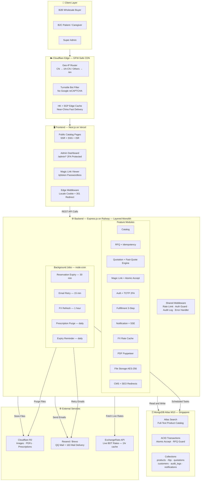
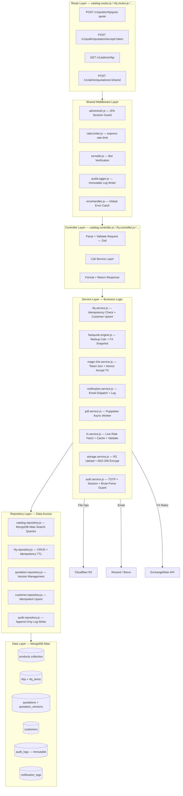
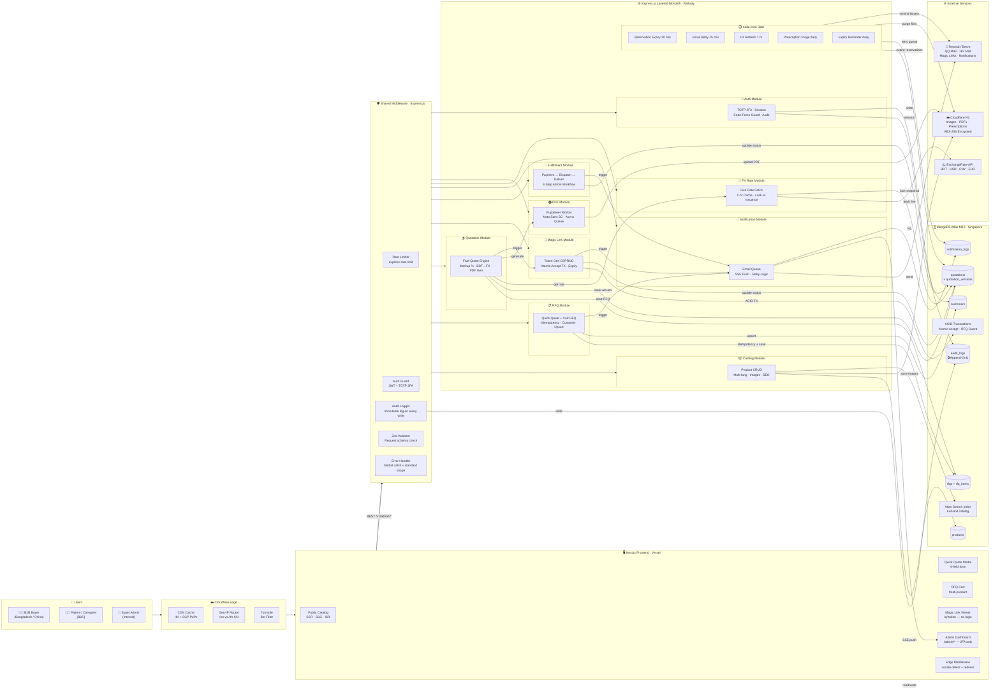

# MedAxis Global Pharma — System Architecture Document
**Version:** 1.0 Draft  
**Architecture Pattern:** Layered Monolith  
**Date:** November 2026  
**Status:** 🔄 Draft — Pending Final Review

---

## 0. Architecture Diagrams (Visual Overview)

### Diagram 1 — High-Level System Architecture



---

### Diagram 2 — End-to-End Request Flow: Buyer to Fulfillment

```mermaid
flowchart TD
    START(["🌐 Buyer Visits MedAxis Global Pharma"])
    BROWSE["Browse Product Catalog\nSearch by Brand / Generic / Manufacturer"]
    
    QQ["Quick Quote Modal\n4 Fields — Under 10 Seconds"]
    CART["Quotation Cart\nMulti-Product RFQ"]

    SUBMIT["Submit RFQ\nTurnstile Verified + Client Contact Snapshot"]
    IDEM{{"Duplicate Check\nIdempotency Key"}}
    RET_EXIST["Return Existing RFQ Reference\nNo Duplicate Record Created"]
    SAVE["Save RFQ + Link Customer Profile\nGenerate RFQ-XXXX Reference"]
    CONFIRM["Email Confirmation Sent to Buyer"]
    QUEUE["RFQ Appears in Admin Inbox\nSSE Real-Time Alert + Admin Email"]

    ADMIN_REV["Super Admin Reviews RFQ"]
    SOURCE_CHECK{{"Sourcing Feasibility"}}
    UNABLE_FLOW["Admin: Mark Unable to Supply (MF-09)\nStatus: Closed + Automated Email to Buyer"]
    PARTIAL{{"Stock Availability?\nMF-06 Spec"}}
    PARTIAL_Q["Draft Partial Quote\nAvailable Items Quoted\nUnavailable Logged with Buyer Notes"]
    CLARIFY["Admin: Need Clarification\nDirect wa.me or Email Prompt to Buyer"]
    VERIFY["Verify Stock + Procurement Cost BDT\nwith Manufacturer"]

    FASTQ["Open Fast-Quote Console\nBDT Cost + Markup % + Incoterms (FCA/CIP/DAP)"]
    FX["FX Engine\nAuto-Convert to USD / CNY / EUR\nLock Rate Snapshot — BD-005"]
    ISOLATE_COST["Save Batch Cost in quotation_internal_costs\nZero Cost Leakage to Public Doc"]
    PDF_GEN["Generate PDF Async\nPuppeteer + Noto Sans SC"]
    MAGIC["Generate Magic Link Token\nStore SHA-256 Hash Only"]
    SEND_Q["Dispatch Magic Link\nEmail + WhatsApp wa.me"]

    BUYER_VIEW["Buyer Opens Magic Link\n/q/token — Referrer-Policy: no-referrer"]
    DECISION{{"Buyer Decision"}}

    CONFIRM_MODAL["1-Click Confirmation Modal\nLock 5-Day Commercial Allocation"]
    ACCEPT["Confirm Accept"]
    ATOMIC{{"Atomic findOneAndUpdate\nStatus: Sent & validity_date >= now"}}
    LOCKED["Status: Accepted + Locked\n5-Day Allocation Active"]
    REGEN_PDF["Regenerate PDF with ACCEPTED Watermark\n+ Official Bank Wire Proforma Details"]
    SHOW_WIRE["Display Verified Bank Wire Instructions on Screen\n+ Proforma PDF Emailed to Buyer"]
    ADMIN_ALERT["Admin Alert: Accepted Tab\n+ Real-Time Email Notification"]
    
    NEGOTIATE["Chat on WhatsApp / WeChat\nDirect Negotiation"]
    REVISE["Admin Creates Revision v2\nv1 Locked as Superseded"]
    
    DECLINE["Select Decline Reason\nPrice / Lead Time / Other"]
    CLOSED["Status: Declined"]

    PAID["Admin: Mark Payment Received\nLog Bank Wire Ref & Amount"]
    DISPATCH["Admin: Mark Dispatched\nLog Courier + AWB Number\nTracking Email Sent to Buyer"]
    DELIVER["Admin: Mark Delivered\nEmail Sent to Buyer\nTransaction Archived"]

    DAY3_REMIND["Day-3 Payment Reminder Email\nnode-cron Alert"]
    EXPIRE_RES{{"5-Day Window Elapsed?"}}
    STOCK_REL["Allocation Released\nStatus: Payment_Expired\nBuyer Notified by Email"]
    REFRESH_REQ["Buyer Clicks 'Request Updated Quote'\nAdmin Notified to Refresh Sourcing"]

    START --> BROWSE
    BROWSE --> QQ & CART
    QQ --> SUBMIT
    CART --> SUBMIT
    SUBMIT --> IDEM
    IDEM -->|Duplicate| RET_EXIST
    IDEM -->|New| SAVE
    SAVE --> CONFIRM & QUEUE
    QUEUE --> ADMIN_REV
    ADMIN_REV --> SOURCE_CHECK
    SOURCE_CHECK -->|Cannot Source| UNABLE_FLOW
    SOURCE_CHECK -->|Needs Details| CLARIFY --> ADMIN_REV
    SOURCE_CHECK -->|Can Source| PARTIAL
    PARTIAL -->|Some Unavailable| PARTIAL_Q --> FASTQ
    PARTIAL -->|All Available| VERIFY --> FASTQ
    FASTQ --> FX --> ISOLATE_COST --> PDF_GEN --> MAGIC --> SEND_Q
    SEND_Q --> BUYER_VIEW
    BUYER_VIEW --> DECISION
    DECISION -->|Accept| CONFIRM_MODAL --> ACCEPT --> ATOMIC
    ATOMIC -->|Success| LOCKED --> REGEN_PDF --> SHOW_WIRE --> ADMIN_ALERT
    ATOMIC -->|Status != Sent| BUYER_VIEW
    ADMIN_ALERT --> DAY3_REMIND --> EXPIRE_RES
    EXPIRE_RES -->|Payment within 5 days| PAID
    EXPIRE_RES -->|No Payment| STOCK_REL --> REFRESH_REQ --> ADMIN_REV
    PAID --> DISPATCH --> DELIVER
    DECISION -->|Negotiate| NEGOTIATE --> REVISE --> BUYER_VIEW
    DECISION -->|Decline| DECLINE --> CLOSED
    CLOSED -->|Resumed Chat| REVISE
```



---

### Diagram 3 — Layered Monolith Internal Architecture (Express.js)



---

### Diagram 4 — Full System Component & Data Flow Map

> This diagram shows **how every layer connects** — from the user's browser to the database — and which external services each module talks to.



---

## 1. Architecture Philosophy & Decision

### 1.1 Why Layered Monolith?

MedAxis Global Pharma Release 1 is a **single-operator business** (Single Super Admin) with a focused, sequential workflow:  
`Catalog → RFQ → Quotation → Acceptance → Fulfillment`

A **Layered Monolith** is the correct architectural choice at this stage because:

| Factor | Monolith Advantage |
|---|---|
| **Team size** | Single admin operator, small dev team — no need for distributed service ownership |
| **Deployment simplicity** | One deployable unit — no inter-service networking, no service discovery complexity |
| **Transactional integrity** | Critical operations (Atomic Accept, RFQ idempotency) are simpler with a single DB connection |
| **Cost** | No Kubernetes, no message brokers, no multiple server instances needed at launch |
| **Future readiness** | Module boundaries designed so Release 4 can extract modules into microservices if needed |

> [!NOTE]
> The architecture is **modular by design** — each functional domain (Catalog, RFQ, Quotation, etc.) is a self-contained module with its own routes, controllers, services, and repositories. This means extraction into microservices in Release 4 requires minimal refactoring.

---

## 2. Tech Stack

| Layer | Technology | Reason |
|---|---|---|
| **Frontend** | Next.js 14+ (App Router) | SSR/SSG for SEO (crawlable product catalog), `[locale]` routing for `/en` & `/zh-CN`, built-in image optimization |
| **Backend** | Express.js (Node.js 20+ LTS, TypeScript) | Lightweight, strongly-typed, excellent ecosystem for the monolith module pattern |
| **Database** | MongoDB Atlas | Flexible schema for multi-language product data, Atlas Search for catalog, Atlas Transactions for atomic Accept |
| **File Storage** | Cloudflare R2 | S3-compatible, GFW-safe (not blocked in China), cheap egress, signed URLs for prescriptions |
| **CDN** | Cloudflare (Global + Near-China Edge) | GFW-safe, Hong Kong/Singapore PoPs, Turnstile bot protection |
| **Email** | Resend or Brevo (Sendinblue) | SPF/DKIM/DMARC support, good QQ Mail & 163 Mail deliverability, React Email templates |
| **FX Rate** | ExchangeRate-API or Open Exchange Rates | Reliable, cheap, supports BDT, cached in-memory (1-hour TTL) |
| **PDF Generation** | Puppeteer (Headless Chromium) | Best-in-class Chinese character (Noto Sans SC) rendering; runs inside the monolith as an async job |
| **Bot Protection** | Cloudflare Turnstile | Free, GFW-safe (no Google reCAPTCHA), server-side token verification |
| **2FA (TOTP)** | `speakeasy` + `qrcode` npm packages | RFC 6238 compliant, works with Google Auth / MS Auth / 1Password |
| **Search** | MongoDB Atlas Search | Full-text + faceted search on products — no separate Elasticsearch cluster needed |
| **Background Jobs** | `node-cron` (in-monolith) | Simple cron for stock reservation expiry, email retries — no message broker complexity at this stage |
| **Session / Auth** | `express-session` + MongoDB Store | Session for admin panel; Magic Link token for customer quotation access |
| **i18n (Frontend)** | `next-intl` | Best Next.js App Router i18n library; supports `[locale]` path prefix, server components |

---

## 3. Service-by-Service Analysis & Best Approach

এখানে PRD-এর প্রতিটি সার্ভিসের জন্য বেস্ট টেকনিক্যাল অ্যাপ্রোচ বিশ্লেষণ করা হয়েছে:

### 3.1 Catalog Service (Product, Generic, Manufacturer, Category)
**PRD Sections:** 3.1, 6 (Data Model)

| Concern | Approach |
|---|---|
| **Multi-language content** | Store `en` and `zh-CN` as embedded sub-documents inside each Product MongoDB document (e.g., `translations: { en: {...}, zhCN: {...} }`). Avoids JOIN-equivalent `$lookup` for every page load. |
| **Full-text search** | Use **MongoDB Atlas Search** with a custom index on `brand_name`, `generic_name`, `manufacturer`, `therapeutic_category`, and translations. Supports fuzzy matching (typo tolerance), Chinese text tokenization, and faceted filtering — no Elasticsearch cluster. |
| **SSR/SSG for SEO** | Next.js `generateStaticParams` for SSG of Product/Generic/Manufacturer/Category pages at build time. `revalidate` ISR (Incremental Static Regeneration) on content change — pages rebuild when admin updates a product. |
| **301 Redirect Engine** | On slug change, write to `URL_REDIRECT` MongoDB collection. Next.js Edge Middleware checks redirects with an in-memory LRU cache (1-hour TTL, ~500 items max). No separate Cloudflare KV infrastructure needed at launch. |
| **Image optimization** | Product images uploaded to **Cloudflare R2**, served via Cloudflare CDN with WebP/AVIF conversion. Next.js `<Image>` component with explicit `width`/`height` for CLS prevention. |

---

### 3.2 RFQ Service (Quick Quote + Cart RFQ)
**PRD Sections:** 3.2, 4.1

| Concern | Approach |
|---|---|
| **Idempotency guard** | A UUID v4 idempotency key is generated in the browser on form load and submitted as a hidden field. Backend checks this key against a MongoDB `rfq_idempotency_keys` collection with a **TTL index** (auto-expires after 24 hours). Duplicate key returns existing RFQ reference, no new record. |
| **Customer Identity & Poisoning Guard** | Submitted contact data is saved as an immutable `contact_snapshot` on the `RFQ` document. Customer profile resolution queries by `email` (with a partial unique index `{ email: 1 }` where `email != null`). If found, links existing `customer_id` without overwriting customer profile details (protecting against unauthenticated identity poisoning). If China buyer on `/zh-CN/` submits without email, form explicitly requires email to receive the quotation (BD-002). |
| **Idempotency Key Lifecycle** | UUID v4 key generated in browser on page load. On successful submission, browser immediately regenerates a fresh key so consecutive distinct inquiries can be submitted from the same tab. |
| **Uncatalogued items (MF-01)** | `RFQ_ITEM` has `is_uncatalogued: true` flag + `custom_medicine_name` free-text field. Admin sees uncatalogued items highlighted in the RFQ review panel with a "Create Product" shortcut. |
| **Partial availability (MF-06)** | Per RFQ Item, admin sets `item_availability_status`: `AVAILABLE`, `UNAVAILABLE`, or `SOURCING`. Admin can send a **partial quotation** that only includes available items. Unavailable items are logged on the RFQ with a note visible to the customer. |
| **Rate limiting** | Cloudflare Turnstile token validated server-side per submission. Additionally, `express-rate-limit`: max 5 RFQ submissions per IP per 10 minutes. |

---

### 3.3 Quotation & Fast-Quote Engine
**PRD Sections:** 3.3, 4.2, 4.3

| Concern | Approach |
|---|---|
| **Versioning** | `QUOTATION` document holds `current_version` integer. Each version is a separate `QUOTATION_VERSION` document. On "Create Revision": atomically increment version + write new version + set previous version `status: "Superseded"` — all in one MongoDB transaction. |
| **Markup formula** | Computed **server-side only**. Frontend sends `procurement_cost_bdt` + `markup_percent`. Server calculates and returns quoted price. Frontend never computes pricing independently. |
| **FX snapshot (BD-005)** | At quote generation, copy `locked_fx_rate_usd/cny/eur` from the live FX cache into `QUOTATION_VERSION`. These fields are **immutable after write** — enforced by MongoDB `$jsonSchema` validator at the collection level. |
| **Magic Link generation** | `crypto.randomBytes(32).toString('hex')` → 64-char hex token (256-bit entropy). Store `SHA-256(token)` hash in `QUOTATION_VERSION.magic_link_token_hash`. Token only lives in the email/WhatsApp link — never stored in plain text in DB. |
| **Atomic Accept & State Disambiguation (EX-05)** | Atomic `findOneAndUpdate` with filter: `{ _id: versionId, status: "Sent", validity_date: { $gte: today } }`. If matched, writes `{ status: "Accepted", accepted_at: now, reservation_expires_at: now+5days }`. If `matchedCount === 0`, performs an immediate read: if already `Accepted`, returns 200 "Already Accepted"; if `Payment_Expired` or `Validity_Expired`, returns 400 "Quotation expired — click Request Updated Quote"; if `Declined` or `Superseded`, returns 400 with the exact accurate status message. Single-doc update is inherently atomic; multi-doc transaction wraps RFQ status sync. |
| **Cost Confidentiality Isolation** | Internal purchase costs (`procurement_cost_bdt`, `markup_percent`) are stored in a separate `quotation_internal_costs` collection accessible solely by Super Admin. The customer-facing `quotation_versions` document contains zero internal cost fields, eliminating accidental projection leakages. |
| **FX Rate App-Level Immutability** | Enforced via Mongoose `pre('save')` and `pre('findOneAndUpdate')` middleware hooks that throw an error if any `locked_fx_rate_*` attribute is modified after initial creation. |
| **DB write failure on Accept (EH-07)** | Wrap transaction in `try/catch`. On failure: `abortTransaction()`. HTTP 500 response with retry message: *"We couldn't confirm your acceptance. Please try again."* Accept button re-enabled. Failure logged to `AUDIT_LOG`. After 3 consecutive failures on same token → admin alert email. |

---

### 3.4 PDF Generation Service
**PRD Sections:** 3.3 (Dynamic PDF)

| Concern | Approach |
|---|---|
| **Technology** | **Puppeteer** (headless Chromium) running inside the monolith as an async worker. Renders a server-side HTML quotation template with self-hosted `Noto Sans SC` WOFF2 font. Outputs PDF buffer stored to **Cloudflare R2**. |
| **Chinese font** | Self-host `Noto Sans SC` WOFF2 in the backend `public/fonts/` folder. Puppeteer loads it via `@font-face` in the HTML template — guarantees pixel-perfect Chinese character rendering. |
| **Performance & Safety** | PDF generation is **asynchronous** with strict process isolation. Puppeteer runs inside a pooled browser instance (`--no-sandbox`, `--disable-dev-shm-usage`, `--disable-gpu`) with a 15-second timeout to prevent OOM/memory leaks on Railway. Magic Link downloads stream via Express proxy with `X-Robots-Tag: noindex, nofollow` and `Referrer-Policy: no-referrer`. |
| **Accepted Watermark Regeneration** | Upon customer acceptance, the PDF worker re-renders the quotation template with an official **"ACCEPTED / PROFORMA INVOICE"** watermark, official bank wire transfer instructions, and updates the R2 object for ongoing compliance download. |
| **WeChat browser guard** | Frontend Next.js client component detects WeChat UA string (`MicroMessenger`). If detected: hides PDF download button, shows toast: *"To download PDF, tap ··· → Open in Browser."* |
| **Cost isolation** | PDF HTML template is a separate server render that **explicitly excludes** `procurement_cost`, `markup_percent`, and `internal_cost_data`. Verified by acceptance test. |

---

### 3.5 Notification Service
**PRD Sections:** 3.3, 7 (Email Deliverability, Resilience)

| Concern | Approach |
|---|---|
| **Email provider** | **Resend** (recommended) — solid QQ Mail / 163 Mail deliverability, simple REST API, React Email template support. Fallback: **Brevo (Sendinblue)**. |
| **Delivery failure handling** | Wrap every email send in `try/catch`. On failure: log to `NOTIFICATION_LOG` with `{ event, recipient, error, retry_count, next_retry_at }`. `node-cron` retries every 15 minutes, max 3 attempts. After 3 failures → `status: "FAILED_PERMANENT"` + admin alert. |
| **Real-time admin alerts + Offline Email Fallback** | **Server-Sent Events (SSE)** endpoint `/v1/admin/stream` (Express) pushes new RFQs and Accept events live to open admin tabs. **Offline Fallback**: Every new RFQ and quotation acceptance *also* dispatches an immediate high-priority transactional email to the Super Admin's private inbox, ensuring zero missed inquiries when the admin dashboard is closed. |
| **Quotation expiry reminder (NOTIF-06)** | `node-cron` daily at 09:00 UTC+6: query `QUOTATION_VERSION` for `status: "Sent"` and `validity_date = tomorrow`. Send reminder email to customer. |
| **Day-3 Payment Reminder** | `node-cron` daily at 10:00 UTC+6: queries quotations where `status: "Accepted"` and reservation elapsed $ge$ 3 days without payment confirmation. Sends friendly reminder email with wire details. |
| **Reservation expiry + notify (NOTIF-07)** | `node-cron` every 30 minutes: query for `status: "Accepted"` and `reservation_expires_at < now`. Transition to `Payment_Expired`. Releases manufacturer allocation, sends email to customer + admin alert. |
| **EH-07 DB Failure Stdout Fallback** | If MongoDB connection fails during quotation acceptance, the error is immediately written to local Winston logger (`process.stderr`) before attempting to write to `AUDIT_LOG`, ensuring zero audit blind spots even during total database dropouts. |
| **Dispatch & delivery emails (NOTIF-14/15)** | On admin `Mark Dispatched`: auto-send email with courier + AWB tracking info to customer. On `Mark Delivered`: auto-send delivery confirmation email. |

---

### 3.6 Auth & Admin Security Service
**PRD Sections:** 2.3, 7

| Concern | Approach |
|---|---|
| **Admin login** | Step 1: `POST /api/admin/login` → Argon2id password verify → issue `pre_auth_session` cookie → redirect to 2FA screen. Step 2: `POST /api/admin/verify-totp` → `speakeasy.totp.verify()` → issue full `express-session`. |
| **TOTP 2FA** | `speakeasy.generateSecret()` on setup → store `base32` secret encrypted in MongoDB → generate QR code with `qrcode` package. |
| **Brute-force protection** | `express-rate-limit`: 5 failed attempts on `/api/admin/login` → 15-minute IP block in MongoDB. On lockout → dispatch security alert email to owner. |
| **Session** | `express-session` + `connect-mongo`. `httpOnly`, `secure`, `sameSite: "strict"`. Idle timeout: 30 minutes. |
| **Login notification** | On every successful login: async email dispatch with `geoip-lite` IP lookup (country, city), device/UA, UTC timestamp. High-severity alert for new/foreign IP. |
| **Recovery codes** | 8 codes generated via `crypto.randomBytes(6).toString('base64')`. Stored as `bcrypt` hashes in MongoDB array. Single-use: consumed code removed from array + logged to `AUDIT_LOG`. |

---

### 3.7 i18n & SEO Service
**PRD Sections:** 1.3 (A1), 3.1, 7

| Concern | Approach |
|---|---|
| **URL routing** | Next.js App Router `[locale]` segment + `next-intl` middleware. Cloudflare Worker reads `CF-IPCountry` header at edge for Geo-IP routing. `CN` → `/zh-CN/`, Others → `/en/`. Cookie `medaxis_locale` checked first. Never forceful redirect on direct URL access. |
| **Hreflang tags** | Generated server-side in `generateMetadata()`. Uses Next.js `alternates.languages`: `{ en: "...", "zh-CN": "...", "x-default": "/en/..." }`. |
| **XML Sitemap & REST Layering** | Next.js Route Handler `/sitemap.xml/route.ts` fetches published catalog slugs via Express REST endpoint `/v1/public/sitemap-catalog` (preserving the strict architectural rule that frontend does not query database directly). Outputs `<xhtml:link>` hreflang annotations, strictly excluding `/q/*`, `/admin/*`. |
| **Hreflang next-intl Override** | `next-intl` middleware configured with `alternateLinks: false` to prevent automatic Link headers from colliding with page-level canonical and `hreflang` metadata generated in `generateMetadata()`. |
| **On-Demand ISR Revalidation** | Express backend calls Next.js edge endpoint `POST /api/revalidate` with a secure bearer token when products are published, updated, or bulk imported via CSV. |
| **301 Redirect Engine** | Next.js Edge Middleware checks redirects using an in-memory LRU cache (1-hour TTL) backed by a lightweight Next.js edge route. Matches Section 3.1; no Cloudflare Workers KV provisioning required at launch. |

---

### 3.8 FX Rate Service
**PRD Sections:** 3.3, A8 (BD-005)

| Concern | Approach |
|---|---|
| **Live rate fetch** | `node-cron` every 1 hour: ExchangeRate-API → store in MongoDB `EXCHANGE_RATE` + Node.js in-memory `Map` cache (1-hour TTL). |
| **Corrupt data guard (EX-06)** | Validate `rate_to_bdt` is a positive number between `0.1` and `10000`. If invalid → reject update, keep previous rates, dispatch admin alert: *"FX API returned suspicious data — using last known rates."* |
| **API failure fallback (EH-06)** | Fast-Quote console shows: *"Live rates unavailable — using last cached rates from [timestamp]."* Admin can still use Manual Fixed Rates from Admin Settings. |
| **FX snapshot (BD-005)** | At quote generation: snapshot current rates into `QUOTATION_VERSION.locked_fx_rate_*`. Immutable after write — enforced by MongoDB `$jsonSchema`. |

---

### 3.9 File Storage Service
**PRD Sections:** 2.1, 7 (Prescription Privacy)

| Concern | Approach |
|---|---|
| **Provider** | **Cloudflare R2** — 3 buckets: `products` (images), `quotes` (PDFs), `prescriptions` (encrypted). |
| **Prescription encryption** | AES-256-GCM server-side before upload. Encryption key in environment variable (Cloudflare Secret). Admin download triggers server-side decrypt + stream. |
| **Access control** | Signed R2 URLs generated server-side only after verified admin session. URL expiry: 15 minutes. No public bucket policy. |
| **Enhanced Privacy Purge** | `node-cron` daily: queries prescriptions where `created_at < 90 days ago` OR where associated RFQ/Quote has reached any terminal state (`DELIVERED`, `Declined`, `Closed`, `Payment_Expired`) over 14 days ago. Permanently deletes R2 object and sets `purged_at` timestamp, preventing indefinite retention of medical files from unfulfilled inquiries. |
| **File validation** | Server-side: check MIME type with `file-type` npm package (not just extension). Max 5MB at Express multipart middleware level. |

---

---

### 3.10 Fulfillment Service (Offline 3-Step Workflow)
**PRD Sections:** 3.6, 4.3, Flow 3 (Minimal Fulfillment)

| Concern | Approach |
|---|---|
| **Minimal 3-Step Lifecycle** | Single-admin operational workflow: `Accepted` → `Payment_Received` → `Dispatched` → `Delivered`. State transitions validated server-side. |
| **Payment Verification** | Super Admin clicks "Mark Payment Received", logs Bank Wire reference number, received amount, and currency. Activates procurement phase. |
| **Dispatch & Tracking** | Super Admin clicks "Mark Dispatched", enters Courier Name (e.g., DHL, FedEx, Aramex) and AWB Tracking Number. System automatically dispatches tracking email to buyer (`dispatch.tsx`). |
| **Delivery Confirmation** | Super Admin clicks "Mark Delivered" upon courier confirmation. Closes order, triggers delivery confirmation email (`delivered.tsx`), archives transaction. |
| **Stock Reservation Guard** | Acceptance triggers a 5-calendar-day stock reservation. If payment is not confirmed within 5 days, `reservationExpiry.job.ts` automatically releases stock and transitions status to `Payment_Expired`. |

---

## 4. Layered Monolith Project Structure

```
medaxis-global-pharma/
│
├── frontend/                          # Next.js App (SSR/SSG/ISR)
│   ├── app/
│   │   ├── [locale]/                  # /en & /zh-CN routing
│   │   │   ├── layout.tsx             # Locale layout (hreflang, canonical)
│   │   │   ├── page.tsx               # Homepage
│   │   │   ├── products/
│   │   │   │   ├── page.tsx           # Product listing (SSG)
│   │   │   │   └── [slug]/page.tsx    # Product detail (SSG + ISR)
│   │   │   ├── generics/[slug]/
│   │   │   ├── manufacturers/[slug]/
│   │   │   ├── categories/[slug]/
│   │   │   └── services/
│   │   ├── q/
│   │   │   └── [token]/page.tsx       # Magic Link quotation viewer
│   │   ├── admin/                     # Admin panel (server-protected)
│   │   │   ├── layout.tsx             # Admin auth guard
│   │   │   ├── dashboard/page.tsx
│   │   │   ├── rfqs/page.tsx
│   │   │   ├── quotations/page.tsx
│   │   │   ├── catalog/page.tsx
│   │   │   ├── customers/page.tsx
│   │   │   └── settings/page.tsx
│   │   ├── sitemap.xml/route.ts       # Dynamic XML sitemap
│   │   └── robots.txt/route.ts        # Dynamic robots.txt
│   ├── components/
│   │   ├── catalog/                   # Product cards, search, filters
│   │   ├── rfq/                       # Quick Quote modal, Cart
│   │   ├── quotation/                 # Magic Link viewer, action buttons
│   │   └── admin/                     # Admin UI components
│   ├── messages/
│   │   ├── en.json                    # English translations
│   │   └── zh-CN.json                 # Simplified Chinese translations
│   └── middleware.ts                  # Geo-IP locale routing + 301 redirects
│
├── backend/                           # Express.js Layered Monolith
│   ├── tsconfig.json                  # Strict TypeScript config (NodeNext ESM)
│   ├── package.json
│   └── src/
│       ├── server.ts                  # Entry point
│       ├── app.ts                     # Express app factory
│       ├── config/
│       │   ├── db.ts                  # MongoDB Atlas connection (Mongoose)
│       │   ├── env.ts                 # Env config validation (Zod)
│       │   └── constants.ts           # Status enums, limits
│       │
│       ├── modules/                   # Feature modules
│       │   ├── catalog/
│       │   │   ├── catalog.routes.ts
│       │   │   ├── catalog.controller.ts
│       │   │   ├── catalog.service.ts
│       │   │   ├── catalog.repository.ts
│       │   │   └── catalog.schema.ts  # Mongoose schema
│       │   │
│       │   ├── rfq/
│       │   │   ├── rfq.routes.ts
│       │   │   ├── rfq.controller.ts
│       │   │   ├── rfq.service.ts
│       │   │   ├── rfq.repository.ts
│       │   │   └── rfq.schema.ts
│       │   │
│       │   ├── quotation/
│       │   │   ├── quotation.routes.ts
│       │   │   ├── quotation.controller.ts
│       │   │   ├── quotation.service.ts
│       │   │   ├── quotation.repository.ts
│       │   │   ├── quotation.schema.ts
│       │   │   └── fastquote.engine.ts # Pricing formula + FX logic
│       │   │
│       │   ├── magic-link/
│       │   │   ├── magic-link.routes.ts
│       │   │   ├── magic-link.controller.ts
│       │   │   └── magic-link.service.ts # Token gen, SHA-256, atomic Accept
│       │   │
│       │   ├── customer/
│       │   │   ├── customer.routes.ts
│       │   │   ├── customer.service.ts # Idempotent upsert
│       │   │   └── customer.schema.ts
│       │   │
│       │   ├── fulfillment/
│       │   │   ├── fulfillment.routes.ts
│       │   │   ├── fulfillment.controller.ts
│       │   │   └── fulfillment.service.ts # Mark Paid, Dispatched, Delivered
│       │   │
│       │   ├── notification/
│       │   │   ├── notification.service.ts
│       │   │   ├── notification.schema.ts
│       │   │   └── email.templates/
│       │   │       ├── rfq-confirmation.tsx
│       │   │       ├── quotation-sent.tsx
│       │   │       ├── accepted.tsx
│       │   │       ├── expiry-reminder.tsx
│       │   │       ├── dispatch.tsx
│       │   │       ├── delivered.tsx
│       │   │       ├── clarification-request.tsx  # RFQ inquiry clarification
│       │   │       ├── unable-to-supply.tsx       # Terminal MF-09 notification
│       │   │       ├── revision-request.tsx       # Buyer modification request
│       │   │       ├── admin-new-rfq-alert.tsx    # Owner email on new RFQ
│       │   │       └── admin-accepted-alert.tsx   # Owner email on 1-click Accept
│       │   │
│       │   ├── auth/
│       │   │   ├── auth.routes.ts
│       │   │   ├── auth.controller.ts
│       │   │   ├── auth.service.ts    # TOTP, session, brute-force
│       │   │   └── auth.schema.ts
│       │   │
│       │   ├── fx/
│       │   │   ├── fx.service.ts      # Fetch, cache, validate, snapshot
│       │   │   └── fx.schema.ts
│       │   │
│       │   ├── storage/
│       │   │   └── storage.service.ts # R2 upload, signed URL, AES-256
│       │   │
│       │   ├── pdf/
│       │   │   └── pdf.service.ts     # Puppeteer async PDF worker
│       │   │
│       │   └── cms/
│       │       ├── cms.routes.ts
│       │       ├── cms.controller.ts
│       │       ├── cms.service.ts
│       │       └── cms.schema.ts
│       │
│       ├── shared/
│       │   ├── middleware/
│       │   │   ├── adminAuth.ts       # Admin session guard
│       │   │   ├── rateLimiter.ts     # express-rate-limit configs
│       │   │   ├── turnstile.ts       # Cloudflare Turnstile verification
│       │   │   ├── errorHandler.ts    # Global error handler
│       │   │   └── auditLogger.ts     # Immutable audit log writer
│       │   ├── utils/
│       │   │   ├── crypto.ts          # CSPRNG token, SHA-256
│       │   │   ├── geoip.ts           # IP → country (geoip-lite)
│       │   │   └── slugify.ts
│       │   └── validators/
│       │       ├── rfq.validator.ts   # Zod schemas
│       │       └── quotation.validator.ts
│       │
│       └── jobs/                      # node-cron background jobs
│           ├── reservationExpiry.job.ts   # Every 30 min — expire unpaid
│           ├── quotationExpiry.job.ts     # Daily — expire validity-lapsed
│           ├── expiryReminder.job.ts      # Daily — email buyer before expiry
│           ├── notificationRetry.job.ts   # Every 15 min — retry failed emails
│           ├── fxRateRefresh.job.ts       # Every 1 hour — refresh live FX
│           └── prescriptionPurge.job.ts   # Daily — 90-day data purge
```

---

## 5. MongoDB Atlas Data Architecture

### 5.1 Collections & Index Strategy

| Collection | Key Indexes | Notes |
|---|---|---|
| `products` | `{ "translations.en.slug": 1 }` UK Sparse, `{ "translations.zhCN.slug": 1 }` UK Sparse, Atlas Search index | Multilingual catalog & SSG |
| `manufacturers` | `{ "translations.en.slug": 1 }` UK, `{ "translations.zhCN.slug": 1 }` UK, `{ is_active: 1 }` | Certified manufacturers & SEO hubs |
| `generics` | `{ "translations.en.slug": 1 }` UK, `{ "translations.zhCN.slug": 1 }` UK, `{ is_active: 1 }` | Active ingredient hubs & SEO |
| `categories` | `{ "translations.en.slug": 1 }` UK, `{ "translations.zhCN.slug": 1 }` UK, `{ is_active: 1 }` | Therapeutic categories |
| `rfqs` | `{ rfq_number: 1 }` UK, `{ customer_id: 1 }`, `{ status: 1, created_at: -1 }` | Admin queue & contact snapshot |
| `rfq_idempotency_keys` | `{ key: 1 }` UK, **TTL** `{ created_at: 1 }` expires 24h | Duplicate submission protection |
| `prescriptions` | `{ rfq_id: 1 }`, `{ purge_scheduled_at: 1 }` | Encrypted metadata & auto-purge job |
| `quotations` | `{ quotation_number: 1 }` UK, `{ rfq_id: 1 }`, `{ customer_id: 1 }` | Parent quotation wrapper |
| `quotation_versions` | `{ magic_link_token_hash: 1 }` UK, `{ quotation_id: 1, version_number: -1 }`, `{ status: 1, validity_date: 1 }` | Public & buyer facing data |
| `quotation_internal_costs` | `{ quotation_version_id: 1 }` UK | Isolated procurement cost & margins |
| `customers` | `{ email: 1 }` Partial UK (`email != null`), `{ whatsapp_number: 1 }` | Resilient customer directory |
| `cms_banners` | `{ is_active: 1, sort_order: 1 }` | Bilingual homepage banners & alerts |
| `url_redirects` | `{ source_path: 1 }` UK | 301 redirect engine |
| `exchange_rates` | `{ currency_code: 1 }` UK | Cached live & manual fixed rates |
| `notification_logs` | `{ status: 1, next_retry_at: 1 }` | Retry background queue |
| `audit_logs` | `{ actor_id: 1, created_at: -1 }`, `{ entity_type: 1, entity_id: 1 }` | Immutable append-only audit trail |

### 5.2 When to Use MongoDB Transactions

| Operation | Transaction? | Reason |
|---|---|---|
| **Quotation Accept** | ✅ YES | Atomic `findOneAndUpdate` with status check + reservation |
| **RFQ idempotency check + save** | ✅ YES | Read-then-write on idempotency key |
| **Quotation revision create** | ✅ YES | Increment version + write new version + supersede old |
| **FX snapshot at quote generation** | ✅ YES | Read FX rate + write to quotation atomically |
| **Email send + NOTIFICATION_LOG** | ❌ NO | Email is external; log independently |

---

## 6. API Design Conventions

**Base URL:** `https://api.medaxisglobalpharma.com/v1`

```
PUBLIC (No auth — rate limited + Turnstile)
  GET   /v1/public/products                  → Catalog listing (paginated, faceted)
  GET   /v1/public/products/:slug            → Product detail (localized)
  GET   /v1/public/generics/:slug            → Generic ingredient hub
  GET   /v1/public/manufacturers/:slug       → Manufacturer profile
  GET   /v1/public/categories/:slug          → Therapeutic category hub
  GET   /v1/public/sitemap-catalog           → Slugs for Next.js sitemap generator
  POST  /v1/public/rfq/quick-quote           → Submit Quick Quote (multipart or JSON)
  POST  /v1/public/rfq/cart                  → Submit Cart RFQ
  POST  /v1/public/prescriptions/upload      → Upload encrypted prescription (max 5MB)
  GET   /v1/public/quotation/token/:token    → Validate Magic Link (Referrer-Policy: no-referrer)
  POST  /v1/public/quotation/accept/:token   → 1-Click Accept (atomic update, BD-001)
  POST  /v1/public/quotation/request-revision/:token → Submit modification request / notes
  POST  /v1/public/quotation/request-refresh/:token  → Request refreshed quote for expired versions
  POST  /v1/public/quotation/decline/:token  → Decline with structured reason
  GET   /v1/public/quotation/pdf/:token      → Download PDF (proxied, X-Robots-Tag: noindex)

ADMIN (2FA session required)
  POST  /v1/admin/auth/login                 → Step 1: Password authentication
  POST  /v1/admin/auth/verify-totp           → Step 2: TOTP verification
  POST  /v1/admin/auth/2fa/enroll            → Enroll TOTP & generate bcrypt backup codes
  POST  /v1/admin/auth/revoke-sessions       → Revoke all other active sessions
  POST  /v1/admin/auth/logout                → Destroy session
  GET   /v1/admin/rfqs                       → Central RFQ inquiry queue (filterable)
  GET   /v1/admin/rfqs/:id                   → Detailed RFQ view with contact snapshot
  PATCH /v1/admin/rfqs/:id/status            → Update RFQ status
  POST  /v1/admin/rfqs/:id/request-clarification → Send structured clarification email to buyer
  POST  /v1/admin/rfqs/:id/unable-to-supply  → Close RFQ with reason & send MF-09 notification
  POST  /v1/admin/rfqs/:id/notes             → Log internal communication notes
  GET   /v1/admin/prescriptions/:id          → Decrypt and stream customer prescription
  POST  /v1/admin/quotations                 → Create quotation draft with batch cost
  POST  /v1/admin/quotations/:id/send        → Issue quotation (locks FX snapshot, sends email)
  POST  /v1/admin/quotations/:id/resend      → Rotate Magic Link token & re-send email
  POST  /v1/admin/quotations/:id/revise      → Create revision (v2, archives previous as Superseded)
  PATCH /v1/admin/quotations/:id/fulfillment → Mark Paid / Dispatched (AWB) / Delivered
  POST  /v1/admin/catalog/products           → Create pharmaceutical product SKU
  PATCH /v1/admin/catalog/products/:id       → Update product SKU
  POST  /v1/admin/catalog/generics           → Manage generic ingredient master records
  POST  /v1/admin/catalog/manufacturers      → Manage manufacturer master records
  POST  /v1/admin/catalog/categories         → Manage therapeutic categories
  POST  /v1/admin/catalog/import-csv         → Bulk CSV import (100+ SKUs with dry-run)
  GET   /v1/admin/customers                  → Customer directory (B2B & B2C profiles)
  GET   /v1/admin/customers/:id              → Customer inquiry & quotation history
  GET   /v1/admin/audit-logs                 → Immutable security & operational audit log
  GET   /v1/admin/fx-rates                   → Current live & manual FX rates
  PATCH /v1/admin/fx-rates                   → Update Manual Fixed Rates
  POST  /v1/admin/cms/banners                → Manage bilingual site announcements
  GET   /v1/admin/stream                     → SSE real-time RFQ and Acceptance alert stream
```

---

## 7. Deployment Architecture

```
                    ┌──────────────────────────────────────┐
                    │          CLOUDFLARE EDGE              │
                    │  GFW-Safe CDN + Turnstile + WAF       │
                    │  Geo-IP Routing (CF-IPCountry)        │
                    │  HK / SGP PoP for China buyers        │
                    └────────────┬──────────────┬───────────┘
                                 │              │
                    ┌────────────▼──┐    ┌──────▼─────────────┐
                    │  Next.js App  │    │  Express.js API     │
                    │   (Vercel)    │    │   (Railway)         │
                    │  SSR/SSG/ISR  │    │  Node.js 20 LTS     │
                    │  /en /zh-CN   │    │  + node-cron jobs   │
                    └───────────────┘    └──────┬─────────────┘
                                                │
                        ┌───────────────────────┼─────────────────┐
                        │                       │                 │
             ┌──────────▼───────┐  ┌────────────▼──┐  ┌──────────▼──────┐
             │  MongoDB Atlas   │  │ Cloudflare R2  │  │  Resend / Brevo │
             │  M10 (Singapore) │  │  (File Store)  │  │  (Email Service)│
             │  Atlas Search    │  │  Products/PDFs │  │  QQ + 163 Mail  │
             │  Transactions    │  │  Prescriptions │  │  deliverability │
             └──────────────────┘  └────────────────┘  └─────────────────┘
```

### Hosting & Infrastructure Engineering Standards

| Component | Provider / Tool | Architectural Standard |
|---|---|---|
| **Next.js Frontend** | **Vercel** | Edge network, ISR on-demand revalidation (`/api/revalidate`), `next-intl` with `alternateLinks: false`. |
| **Express.js Backend** | **Railway** | Node.js 20 LTS. `app.set('trust proxy', 1)` configured for accurate IP extraction via `cf-connecting-ip`. |
| **MongoDB Database** | **Atlas M10 (Singapore)** | Singapore AWS region (minimal latency to Mainland China & Bangladesh). Automated daily encrypted snapshots with PITR. |
| **File Storage** | **Cloudflare R2** | S3-compatible, GFW-resilient, AES-256 encrypted prescriptions bucket, signed URLs. |
| **Edge & Bot Defense** | **Cloudflare** | Turnstile bot protection on forms; custom SSL/TLS Full (Strict) behind Vercel. |
| **Analytics** | **Plausible Analytics** | Lightweight, cookie-free, 100% GFW-safe (no Google Analytics). `/q/*` excluded from tracking. |
| **Uptime & Alerting** | **Uptime Kuma** | Probes every 60s. Immediate Telegram & Email alerts to Super Admin upon downtime. |
| **Background Cron Scaling** | **node-cron (MVP) → Agenda (Scale)** | Single Railway instance runs in-memory `node-cron`. When scaling to multi-instance backend, transition to MongoDB-backed `agenda` to prevent duplicate job executions. |

---

## 8. Open Questions — Before Finalizing Architecture

> [!WARNING]
> নিচের ৫টি সিদ্ধান্ত আর্কিটেকচার লক করার আগে নিতে হবে:

| # | Question | Why It Matters |
|---|---|---|
| **Q1** | Frontend (Next.js) ও Backend (Express.js) কি একই **monorepo** (Turborepo/pnpm workspace), নাকি আলাদা আলাদা repo? | CI/CD pipeline, shared type definitions |
| **Q2** | Admin panel কি Next.js-এরই একটি route হবে (`/admin/*`), নাকি আলাদা subdomain (`admin.medaxisglobalpharma.com`)? | Auth cookie scope, CORS, session security |
| **Q3** | Real-time admin notification — **SSE** (Server-Sent Events, one-way push) চলবে, নাকি simple **30-second polling** prefer করো? | Backend connection load, infrastructure cost |
| **Q4** | Product images কি admin **R2-তে আপলোড** করবে (via admin panel), নাকি **external URL** দিয়ে link করবে? | Storage bucket setup, image optimization |
| **Q5** | Email provider: **Resend** (simpler API, newer) নাকি **Brevo** (larger company, more features)? | Email integration, pricing |

