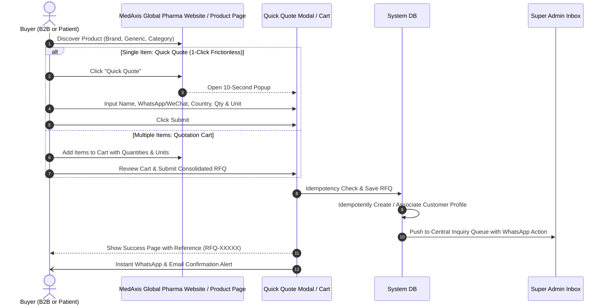
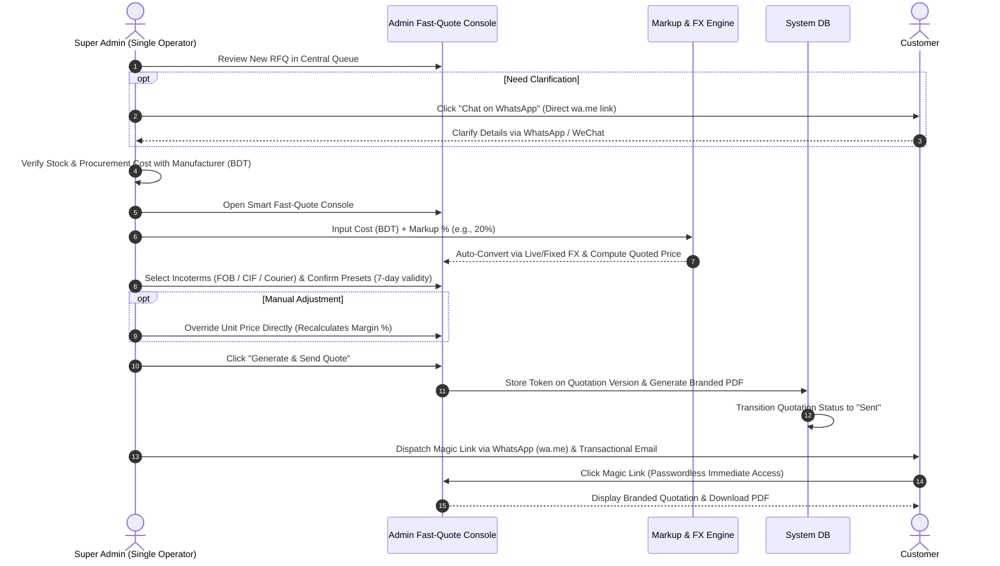
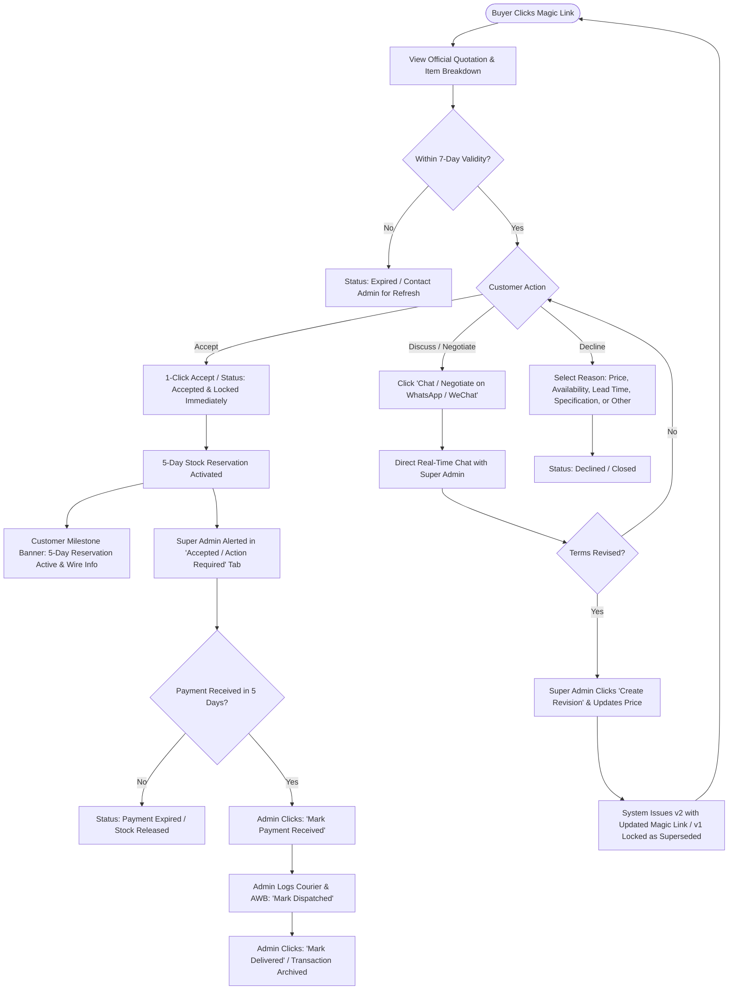
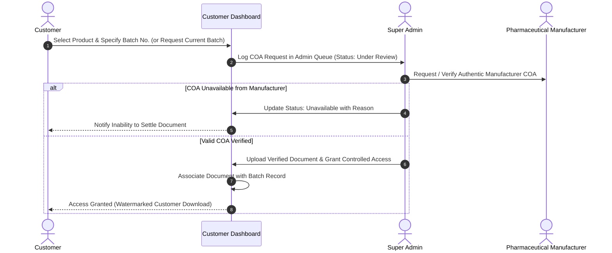

# Product Requirements Document (PRD)
## MedAxis Global Pharma — Pharmaceutical Sourcing & Quotation Platform

**Document Version:** 1.1 (Comprehensive Enterprise Architecture & International SEO Baseline)  
**Status:** Approved Specification  
**Source Document:** `Idea.md` (MedAxis Global Pharma Business and Website Workflow)  
**Target Release:** Release 1 (Core RFQ & Quotation Management) with roadmap for Releases 2–4  

---

## 1. Project Overview & Business Model

### 1.1 Executive Summary
**MedAxis Global Pharma** is a specialized, Bangladesh-based pharmaceutical sourcing and quotation platform designed to connect certified pharmaceutical manufacturers with global wholesale buyers (B2B) and individual patients/caregivers (B2C). 

Unlike standard e-commerce platforms, MedAxis Global Pharma operates strictly on a **Request for Quotation (RFQ) and private quotation model**. Public pricing is deliberately hidden to protect manufacturer contracts, accommodate fluctuating wholesale procurement costs, and allow tailored commercial terms based on volume, destination, and regulatory documentation requirements.

### 1.2 Core Business Model
1. **Catalog Maintenance**: The platform manages an extensive catalog of pharmaceutical products, directly attributing each product to its certified **Manufacturer** (e.g., Beximco, Incepta, Square, Beacon). **There is no separate "Supplier" entity or intermediary vendor directory in the system.**
2. **Product Requirement Collection**: Customers browse products without public pricing, compile single or multi-item quotation lists with exact packaging units, and submit structured RFQs.
3. **Internal Sourcing & Verification**: The MedAxis Global Pharma team verifies physical availability, minimum order quantities (MOQ), lead times, and procurement costs for the manufacturer's products.
4. **Custom Quotation Delivery**: A private, multi-currency quotation is issued directly to the customer's portal with full version tracking.
5. **Fulfillment Tracking**: Once a quotation is accepted, manual operational tracking ensures payment verification, procurement, dispatch, and delivery.

### 1.3 Key Architectural & Business Assumptions
* **A1 — Dual-Language URL Structure & Advanced International SEO (`/en` and `/zh-CN`)**:
  * The platform operates with dedicated, localized URL path prefixes: `/en/...` for English and `/zh-CN/...` for Simplified Chinese.
  * **Strict SEO & Crawler Indexing**: Every localized page includes reciprocal `<link rel="alternate" hreflang="...">` tags and self-referential canonical tags:
    * `hreflang="en"` pointing to the page's English URL (e.g., `https://medaxisglobalpharma.com/en/products/osimert-80mg`).
    * `hreflang="zh-CN"` pointing to the page's Simplified Chinese URL (e.g., `https://medaxisglobalpharma.com/zh-CN/products/osimert-80mg`).
    * `hreflang="x-default"` pointing to the **equivalent English URL of that exact entity/page** (e.g., `https://medaxisglobalpharma.com/en/products/osimert-80mg`), serving as the international fallback rather than collapsing to the root homepage.
    * Self-referential canonical tags: The `/en/...` URL points canonically to itself; the `/zh-CN/...` URL points canonically to itself.
  * **First-Visit Soft Geolocation & Locale Routing**:
    * When a visitor arrives at the root domain (`/`), server-side edge logic evaluates the visitor's IP location (Geo-IP) and browser `Accept-Language` header:
      * Visitors from Mainland China (`CN`) or with Chinese browser locale default to `/zh-CN/`.
      * Visitors from all other countries or unresolvable IPs default to `/en/`.
    * **Non-Blocking / Never Forcible**: If a user outside China (or on a VPN) navigates directly to a `/zh-CN/...` URL, the system **never forces a redirect back to English**. The URL path always governs the active language.
    * **Persistent Override**: Changing language via the header switcher (`EN | 简体中文`) writes a persistent cookie (`medaxis_locale`, expiry: 365 days), which permanently overrides Geo-IP routing on subsequent sessions.
* **A2 — Zero Public Pricing**: Under no circumstances are retail or wholesale prices displayed on public-facing pages or in structured data.
* **A3 — Frictionless Submission & Passwordless Magic Link Access**:
  * Prospective buyers can submit single-product Quick Quotes or multi-product Cart RFQs immediately without being blocked by prior account registration or password creation.
  * The platform idempotently creates or associates a Customer Profile in the background using their phone/WhatsApp and email.
  * Quotations, revisions, and decisions are accessed securely via cryptographically signed, tokenized **Magic Links** (`/q/[token]`) dispatched to the buyer's WhatsApp and **Email** — eliminating forgotten-password barriers while preserving tenant security.
* **A4 — Discrete Lifecycle States with Release 1 Minimal Model & Release 3 Migration Plan**:
  * RFQs, Quotations, Payments, and Shipments possess independent lifecycle states.
  * **Release 1 Implementation**: To maintain simplicity for a single operator, minimal fulfillment milestones (`payment_received_at`, `payment_amount`, `dispatch_carrier`, `dispatch_awb_number`, `delivered_at`) are recorded directly on the `QUOTATION_VERSION` record.
  * **Release 3 Migration Plan**: When multi-user operations and ERP/warehouse integrations launch in Release 3, an automated database migration script extracts accepted quotation fulfillment records into discrete `ORDER_RECORD`, `PAYMENT_RECORD`, and `SHIPMENT_RECORD` entities with zero data loss or downtime.
* **A5 — Non-Discretionary Medical Boundaries**: Product relationships do not constitute medical substitution advice. Prescription upload by patients is entirely **optional** at all stages (inquiry, quotation, acceptance, payment, dispatch) and does not block any part of the fulfillment workflow.
* **A6 — Great Firewall (GFW) Resilience & China-Safe Tech Stack**:
  * **Zero Google-Blocked Dependencies**: The platform completely avoids third-party scripts blocked or throttled in Mainland China (strictly no Google Fonts, Google reCAPTCHA, Google Tag Manager, or Google APIs on public/customer screens).
  * **China-Compatible Spam Protection**: Cloudflare Turnstile or hCaptcha replaces Google reCAPTCHA to ensure uninterrupted form submissions inside China.
  * **Self-Hosted & Native Typography**: Uses optimized system font stacks (`PingFang SC`, `Microsoft YaHei`, `Noto Sans SC`) and self-hosted web fonts rather than remote CDN calls.
  * **Near-China CDN Edge Delivery**: Static assets and API caching are routed through near-China edge nodes (Hong Kong / Singapore) to deliver stable latency inside China without requiring an immediate Mainland ICP license.
  * **[BD-002 LOCKED] China Buyer Communication Channel — Email Primary**: Magic Links, quotation notifications, and all system-generated alerts for Mainland China buyers (`/zh-CN/`) are delivered via **transactional Email** (optimized for QQ Mail `@qq.com` and 163 Mail `@163.com`). WhatsApp is unavailable in China without a VPN. WeChat QR code and WeChat ID are displayed prominently on the website and quotation page for buyers to initiate direct manual contact with the Super Admin, but WeChat is **not used as an automated system notification channel** in Release 1.
* **A7 — [BD-003 LOCKED] Exclusive Direct Manufacturer Sourcing**: MedAxis Global Pharma sources and attributes all pharmaceutical products **exclusively and directly from licensed pharmaceutical manufacturers** (e.g., Beacon, Beximco, Incepta, Square). There is no supplier, broker, or distributor layer in the data model. Internal procurement costs are recorded directly against the manufacturer record. This is a confirmed, permanent business decision.
* **A8 — [BD-004 LOCKED] Fixed Exchange Rate at Quotation Issue — FX Risk Policy**: The exchange rate applied at the moment the Super Admin issues a quotation is **permanently fixed and locked** for that quotation version. Currency fluctuations during the 7-day validity window and the subsequent 5-day stock reservation period are absorbed by the Super Admin through built-in safety margin at the time of quoting. The customer's confirmed price in USD/CNY/EUR does not change post-issuance.
* **A9 — [BD-001 LOCKED] No OTP for Quotation Acceptance**: Quotation acceptance requires **no OTP, SMS code, or additional verification step**. The buyer clicks `[Accept Quotation]` on the Magic Link page and the quotation is immediately locked to `Accepted` status. The cryptographically signed 256-bit Magic Link token itself constitutes sufficient proof of identity and commercial intent.

### 1.4 Strategic Business Goals & Target Success Metrics (KPIs)
| Metric / KPI | Target Benchmark | Measurement & Evaluation Method |
| :--- | :--- | :--- |
| **Inquiry-to-Quotation Turnaround (SLA)** | **< 2 Hours** (during business hours 09:00–21:00 UTC+6) | Measured from RFQ submission timestamp to quotation `Sent` timestamp. Powered by the Smart Fast-Quote engine. |
| **Quotation Acceptance Rate** | **$\ge$ 25%** | Percentage of sent quotations successfully accepted by buyers via 1-click confirmation modal. |
| **Inquiry Submission Friction** | **< 10 Seconds** (Quick Quote) | Time required for a visitor to complete the 4-field Quick Quote modal on mobile or desktop. |
| **Quotation Formulation Speed** | **< 60 Seconds** (Super Admin) | Time required for the Super Admin to input cost, set markup, and generate a multi-currency quotation with presets. |
| **Global Page Load Speed** | **< 1.5 Seconds** (Global CDN) | First Contentful Paint (FCP) evaluated across European, North American, and Asian test nodes. |
| **Mainland China Page Load Speed** | **< 2.0 Seconds** (Near-China CDN) | Evaluated through Hong Kong / Singapore edge nodes across Beijing, Shanghai, and Guangzhou monitoring nodes. |
| **Core Web Vitals (CWV)** | **$\ge$ 75th percentile Pass** | **LCP $\le$ 2.5s**, **INP $\le$ 200ms**, **CLS $\le$ 0.1** on mobile and desktop field data (Google Search Console & CrUX). |
| **Organic Sourcing Conversion Funnel** | **Baseline established in Month 1** | Monitored path: `Organic Search Landing` $\rightarrow$ `Catalog/Generic Page View` $\rightarrow$ `RFQ Submission` $\rightarrow$ `Accepted Quotation`. |
| **Zero Pricing Data Leakage** | **100% Compliance** | Zero public pricing exposed in static pages, client JS bundles, network payloads, unauthenticated API endpoints, or Schema.org structured data. |
| **Privacy-Compliant Analytics** | **100% GFW Resilience** | Analytics tracked via lightweight, privacy-friendly analytics (**Plausible** or self-hosted **Matomo**) instead of blocked Google Analytics. |

---

## 2. Target Users & Stakeholder Roles

### 2.1 User Personas (External)

| Persona | Primary Goals | Key Attributes / Requirements |
| :--- | :--- | :--- |
| **B2B Wholesale Buyer**<br>*(Distributors, Clinics, Pharmacies, Importers)* | Sourcing commercial pharmaceutical volumes, obtaining competitive FOB/CIF quotations, securing regulatory documentation (COA, batch specs). | • Company Name required.<br>• Commercial volume requirements with explicit units (e.g., cartons, boxes).<br>• Port of destination and customs requirements.<br>• Needs multi-product RFQ and revision negotiation. |
| **B2C Patient / Caregiver**<br>*(Oncology & Critical Care Patients)* | Sourcing hard-to-find specialized medicines for personal medical use. | • Individual identity (no company required).<br>• Single or low-quantity pack sizes.<br>• **Prescription Upload (Strictly Optional)**: Prescription upload is completely **optional at all stages** (not mandatory for inquiry, quotation acceptance, payment, or dispatch; does not block fulfillment). If a patient chooses to upload a prescription for reference, clear form guidance applies: restricted to `JPEG`, `PNG`, or `PDF` formats; maximum file size capped at **5MB**.<br>• **Prescription Review & Storage**: If uploaded, Super Admin reviews it for informational context. Customer communication continues on WhatsApp/WeChat/Email.<br>• **Data Retention & Privacy (Enhanced Purge)**: Uploaded prescription files are AES-256 encrypted at rest and permanently purged after **90 days from upload**, OR **within 14 days of any terminal state** (`DELIVERED`, `Declined`, `Closed / Unable to Supply`, `Payment_Expired`), whichever occurs first. This guarantees unfulfilled, declined, or expired RFQ medical files are not retained indefinitely.<br>• Simplified communication and clear delivery timelines. |

### 2.2 System Roles & Internal Operations (Single Super Admin Model)

> [!IMPORTANT]
> **Single Super Admin Architecture (Launch Phase)**:
> In the current phase, there are **no separate staff user accounts or internal departmental roles**. All administrative, sourcing, quotation, verification, and content management responsibilities are centralized and executed by a single **Super Admin (Business Owner / Operator)**.
>
> Multi-user role delegation (e.g., dedicated sales reps, sourcing agents, finance officers) is intentionally deferred to future expansion phases. However, the system architecture and database design will remain modular so multi-role delegation can be activated when the team expands without requiring refactoring.

| Role | Operational Scope & Responsibilities | System Access Level |
| :--- | :--- | :--- |
| **Super Admin / Business Owner**<br>*(Single Operator for All Admin Functions)* | • **Product & CMS Management**: Create, edit, publish, translate, and archive products, generics, therapeutic categories, banners, and announcements.<br>• **Master Data & Manufacturers**: Manage master records of certified pharmaceutical manufacturers, packaging units, and currencies (no supplier entity exists).<br>• **RFQ Intake & Clarification**: Review all incoming customer inquiries, assess requirement completeness, trigger clarification questions, and log offline WhatsApp/WeChat discussion notes.<br>• **Sourcing & Stock Verification**: Verify physical stock availability, procurement costs, MOQs, and lead times for the manufacturer's products.<br>• **Quotation Formulation & Issuance**: Calculate commercial margins, set unit prices and freight costs, draft quotations, generate PDFs, and issue quotes directly to customers.<br>• **Revision & Negotiation**: Review customer revision requests, negotiate terms, and issue versioned revisions (`v2`, `v3`).<br>• **Fulfillment & Verification (Later Phases)**: Verify offline bank payments, confirm purchase orders, log shipment tracking, and release verified manufacturer COA documents.<br>• **Platform Configuration & Audit**: Full control over system settings, currency rates, email templates, and audit logs. | **Full Unrestricted Access** across all admin modules, pricing margins, master databases, customer requests, and system logs. |

### 2.3 Super Admin Account Hardening & Security Governance

> [!CAUTION]
> **Single Point of Failure (SPOF) Defense**:
> Because the Single Super Admin account possesses full commercial visibility (supplier purchase costs, profit margins, private customer quotations, and unreleased documentation), the account represents a high-value attack target. Compromise of this single identity compromises the entire business. Therefore, strict enterprise-grade account hardening is non-negotiable.

* **Mandatory Multi-Factor Authentication (2FA / MFA)**:
  * Mandatory TOTP-based 2FA (compatible with Google Authenticator, Microsoft Authenticator, Apple Keychain, or 1Password).
  * Enrollment is enforced upon initial account setup; no administrative screen can be accessed without active 2FA.
* **Instant Login Notifications & Anomaly Alerts**:
  * Real-time automated transactional email is dispatched immediately upon every successful Super Admin login.
  * Email alert payload specifies: exact timestamp (UTC & local), IP address, country/city geolocation, device type, operating system, and browser User-Agent.
  * Dispatches high-severity alert if login occurs from a previously unseen IP range or foreign jurisdiction.
* **IP, Device & Active Session Management**:
  * Persistent security audit logging of all administrative sessions (`ADMIN_SESSION`).
  * Live active session manager in Admin Settings displaying current active sessions with remote **"Revoke All Other Sessions"** capability.
  * Automated idle session timeout enforcing re-authentication after 30 minutes of inactivity.
* **Cryptographic Recovery & Break-Glass Protocol**:
  * Upon 2FA configuration, the system generates **8 single-use, cryptographically random backup recovery codes**.
  * Backup codes are securely hashed using bcrypt (cost factor 12) in the database; once a code is consumed, it is permanently invalidated.
  * If the authenticator device is lost, account recovery requires:
    1. Primary password authentication,
    2. Submission of a valid, unconsumed backup recovery code, and
    3. Out-of-band email confirmation link sent to the verified owner email.
* **Brute-Force & Rate-Limiting Controls**:
  * 5 consecutive failed login attempts trigger an immediate 15-minute IP lockout and an automated security warning email to the owner.

---

## 3. Core Features by Functional Area

### 3.1 Public Website & Product Catalog (Release 1)
* **Intelligent Dual-Language Engine & Advanced SEO Routing (`/en` & `/zh-CN`)**:
  * Complete bilingual system supporting **English (`en`)** and **Simplified Chinese (`zh-CN`)** with explicit sub-path routing: `/en/...` and `/zh-CN/...`.
  * **Crawler-Readable Server-Side Rendering (SSR/SSG)**: Public catalog pages (Products, Generics, Categories, Manufacturers, and Services) are rendered server-side. Initial HTTP `GET` responses deliver complete, semantic HTML containing product titles, generic names, strengths, manufacturer information, and technical specifications so crawlers (Googlebot, Baidu Spider, Bingbot) can parse full page content without client-side JavaScript execution dependencies.
  * **Reciprocal Hreflang & Entity-Level Canonical Architecture**:
    * Every public page serves reciprocal `<link rel="alternate" hreflang="...">` tags matching its localized counterpart:
      * `hreflang="en"` pointing to the English version.
      * `hreflang="zh-CN"` pointing to the Simplified Chinese version.
      * `hreflang="x-default"` pointing to the **equivalent English URL of that specific entity/page** (not the generic root homepage).
    * **Self-Referential Canonicals**: The `/en/...` URL contains a canonical pointing to itself; the `/zh-CN/...` URL contains a canonical pointing to itself.
  * **Soft Geolocation & Initial Locale Routing**:
    * Visitors requesting root domain (`/`) undergo edge-level evaluation of Geo-IP and browser `Accept-Language` headers:
      * China IP or Chinese browser locale $\rightarrow$ Redirect to `/zh-CN/`.
      * All other international IPs or unresolvable locales $\rightarrow$ Redirect to `/en/`.
    * **Direct URL Integrity**: Directly entered URLs (e.g., a buyer in the US or on a VPN opening a `/zh-CN/` link) strictly serve Chinese without forced redirection. The URL path always dictates the render.
    * **Persistent Manual Switcher**: Prominent toggle in top header (`English | 简体中文`). Selection writes to persistent cookie `medaxis_locale`, overriding automated geo-routing on subsequent visits.
* **Dedicated Search Intent Landing Pages (Release 1)**:
  * **Product Detail Pages**: Clean, semantic URLs: `/en/products/[slug]` and `/zh-CN/products/[slug]`.
  * **Generic Active Ingredient Landing Pages**: Dedicated hubs for active pharmaceutical ingredients (APIs): `/en/generics/[slug]` and `/zh-CN/generics/[slug]` (e.g., `/en/generics/osimertinib`). Aggregates all available branded formulations manufactured in Bangladesh with cross-links to respective product pages.
  * **Manufacturer Profile Landing Pages**: Dedicated authority pages for licensed pharmaceutical manufacturers: `/en/manufacturers/[slug]` and `/zh-CN/manufacturers/[slug]` (e.g., `/en/manufacturers/beacon-pharmaceuticals`). Outlines manufacturer background, cGMP/WHO certifications, and their complete catalog available through MedAxis Global Pharma.
  * **Therapeutic Category Pages**: High-level therapeutic directory: `/en/categories/[slug]` and `/zh-CN/categories/[slug]` (e.g., Oncology, Hematology, Critical Care).
  * **Institutional Sourcing & Export Services Page**: Dedicated commercial procurement landing pages: `/en/services/pharmaceutical-sourcing` and `/zh-CN/services/pharmaceutical-sourcing` capturing high-intent B2B search queries (e.g., *"Bangladesh oncology exporter"*, *"source oncology medicines from Bangladesh"*).
* **Faceted Navigation & Crawl Budget Safeguards**:
  * Dynamic sorting, facet filters, or pagination combinations (e.g., `?sort=name_asc&manufacturer=beacon&page=2`) must include canonical tags pointing back to the clean base category/listing URL (or return `<meta name="robots" content="noindex, follow">`), strictly preventing index bloat and search crawler budget exhaustion.
* **Pharma Image SEO & Web Performance Guardrails**:
  * High-resolution packaging images served in modern responsive formats (**WebP** / **AVIF**) with responsive `srcset` support.
  * Explicit `width` and `height` attributes (or CSS aspect-ratio locks) to eliminate Cumulative Layout Shift (CLS $\le 0.1$).
  * Descriptive, localized image filenames (e.g., `osimert-80mg-beacon-pack.webp`) and structured localized `alt` attributes (`alt="Osimert 80mg Osimertinib tablets by Beacon Pharmaceuticals packaging box"`).
* **Header & Global Navigation**:
  * Contact info (Phone, Email, WeChat QR/ID, WhatsApp link).
  * Navigation links: Home, Products, Services, About Us, Contact (*Blog deferred to Release 2*).
  * Header actions: Global Search, Language Selector (EN / ZH), Quotation Cart badge. (Customer self-service account login deferred to Release 3; Release 1 is 100% passwordless via Magic Links).
  * Dismissible announcement bar for operational notices or trade announcements (bilingual).
  * **Mainland China Direct Channels**: On Chinese locale (`/zh-CN/`), display prominent WeChat ID and scan-to-chat QR code modal alongside WhatsApp to support users behind the Great Firewall.
* **Multi-Faceted Search & Filtering**:
  * Search by **Brand Name**, **Generic Name**, **Manufacturer**, and **Therapeutic Category**.
  * Fallback mechanism: If a search yields zero matches, display a prominent **"Send Your Requirement"** action enabling the user to submit an uncatalogued requirement (capturing custom medicine name and strength without requiring a pre-existing catalog foreign key).
* **Product Detail Display (Zero Public Pricing & YMYL Medical Transparency)**:
  * Brand Name, Generic Name, Strength, Dosage Form, Pack Size.
  * Manufacturer name and Therapeutic Category.
  * High-resolution packaging images, storage conditions, and indication summary.
  * **YMYL (Your Money Your Life) Medical Review Metadata**: Visible verification metadata including licensed manufacturer attribution, active ingredient chemical specification, and a clearly displayed *"Last Medically / Technically Reviewed Date"* to establish search engine authority and buyer trust.
  * High-level customer availability indicator (e.g., "Available on Order").
  * Related products carousel (with explicit disclaimer: *Related products do not constitute medical substitution advice*).
  * Direct action buttons: `Quick Quote (1-Click Popup)`, `Add to Multi-Product List`, `WhatsApp Inquire`, `WeChat Contact`.

### 3.2 Dual RFQ Submission Pathways & Frictionless Onboarding (Release 1)
* **Path A: "Quick Quote / 1-Click RFQ" (Instant Modal)**:
  * Optimized for single-product inquiries from individual patients (B2C) or fast-moving wholesale buyers.
  * Clicking `Quick Quote` on any product card or detail page opens a lightweight popup modal without leaving the page.
  * Captures only 4 essential fields:
    1. **Full Name**
    2. **WhatsApp / WeChat Number** (or Email)
    3. **Destination Country**
    4. **Quantity & Packaging Unit** (e.g., "3 Boxes", "500 Vials")
  * Optional fields: Target Delivery Date, Patient Prescription Upload, and Brief Line Note.
  * **Strict Prescription Upload Guardrails**: Form provides explicit visual instructions: allowed file formats `JPEG`, `PNG`, `PDF`; maximum file size strictly **5MB** (client-side and server-side validation rejecting files > 5MB with friendly error message).
  * Submission takes under 10 seconds.
* **Path B: "Quotation Cart / Multi-Product RFQ"**:
  * Optimized for commercial wholesale buyers (B2B) sourcing multiple pharmaceutical SKUs in a consolidated shipment.
  * Multi-item cart maintains line-level quantities and mandatory packaging units (e.g., Cartons, Boxes, Vials).
  * Consolidated inquiry form capturing: Destination Country, Destination Port/City, Preferred Currency (USD, EUR, CNY, BDT), Required Regulatory Documents, and General Logistics Notes.
  * **[MF-06 SPEC] Partial Cart RFQ Availability Flow**:
    * When reviewing a multi-item Cart RFQ, the Super Admin evaluates availability per line item.
    * For each `RFQ_ITEM`, the admin selects an `item_availability_status`: `AVAILABLE`, `UNAVAILABLE`, or `SOURCING`.
    * If only a subset of requested items is in stock, the Super Admin can issue a **Partial Quotation** containing only the `AVAILABLE` lines.
    * Unavailable lines are retained on the quotation record with status `UNAVAILABLE` and an admin-provided customer-facing note (e.g., *"Currently out of production by manufacturer; alternative generic recommended"*).
    * The buyer's Magic Link quotation view clearly distinguishes between quoted/available items and unavailable items, ensuring complete transparency without blocking the order of available medicines.
* **Frictionless Submission & Background Account Identity**:
  * **No Prior Registration or Password Wall**: Prospective buyers can submit either a Quick Quote or Cart RFQ immediately as guests.
  * The system idempotently creates or associates a Customer Profile in the background using their phone/WhatsApp and email.
  * Account passwords are not required to submit inquiries or view quotes. An optional password can be set later if the customer wishes to access a persistent self-service dashboard.
  * **Idempotency & Guard**: Duplicate submission guard prevents accidental double-submissions.
  * System generates a unique RFQ Reference Number (e.g., `RFQ-2026-00123`), displays an instant on-screen success confirmation, and dispatches an automated confirmation email to the buyer (automated WhatsApp messaging is deferred to Release 4; WhatsApp is available for direct manual chat via `wa.me` deep links).

### 3.3 Sales Quotation, Smart Fast-Quote & Versioning Engine (Release 1)
* **Unified Inquiry Queue & Contact Shortcuts**:
  * In the single Super Admin model, all incoming Quick Quotes and Cart RFQs feed directly into the central Super Admin queue.
  * Each inquiry record displays a one-click **"Chat on WhatsApp"** (`wa.me`) deep-link and **"Copy WeChat ID / Message"** action, allowing the Super Admin to immediately initiate communication with the buyer manually without external API billing.
  * Manual recording of external discussions (WhatsApp / WeChat call summaries) into internal admin inquiry notes.
  * **[MF-09 SPEC] "Unable to Supply" Terminal RFQ Flow**:
    * When the Super Admin cannot source any requested item in an RFQ (e.g., discontinued by manufacturer, regulatory export embargo, or MOQ/lead-time infeasible), the admin triggers the **"Unable to Supply"** action from the RFQ management console.
    * The Super Admin selects a predefined reason (`Discontinued by Manufacturer`, `Regulatory / Export Restriction`, `MOQ Infeasible`, `Unobtainable Lead Time`, `Other`) and enters an optional personalized note.
    * The RFQ transitions directly to terminal status `Closed` (with field `close_reason: "Unable to Supply"` and audit log entry).
    * The system automatically dispatches a professional transactional email to the customer explaining that MedAxis Global Pharma cannot fulfill this inquiry at this time, providing the specific reason and inviting them to inquire about alternative generic equivalents.
    * No quotation record or pricing draft is created, preventing pipeline clutter.
* **Smart Fast-Quote Engine (Markup Formula, FX Engine & Manual Override)**:
  * Interactive quotation builder designed to generate an official quote in **under 60 seconds**:
    * **Procurement Cost & Markup Calculation**: Super Admin inputs the local procurement/purchase cost (in BDT, e.g., ৳5,000) and sets the desired `Target Markup %` (e.g., 20%):
      $$\text{Quoted Price (Base BDT)} = \text{Procurement Cost (BDT)} \times \left(1 + \frac{\text{Markup \%}}{100}\right)$$
    * **Dual-Mode Currency Conversion (Live FX + Manual Fixed Override)**: System provides live currency rates, while allowing the Super Admin to configure **Manual Fixed Rates** in Admin Settings (e.g., 1 USD = 122 BDT; 1 CNY = 16.8 BDT) to hedge against exchange fluctuations during the quotation validity window.
    * **Full Manual Price Override**: While the system auto-calculates the price, the Super Admin has **full freedom to manually edit/override the final unit price** (e.g., rounding `$48.72` to `$50.00` or applying a special flat rate). When adjusted, the console dynamically recalculates and displays the effective gross margin percentage and net profit in real time.
    * **Pharmaceutical Incoterms & Cold-Chain Shipping Terms**:
      * Dropdown selection on quote header supporting air cargo and temperature-controlled biologics:
        * **FCA** (Free Carrier, Dhaka International Airport — Standard Air Cargo baseline)
        * **CIP** (Carriage and Insurance Paid to Destination Airport — Mandatory for high-value cold-chain)
        * **CPT** (Carriage Paid to Destination Airport)
        * **DAP** (Delivered at Place / Express Door-to-Door Courier — DHL, FedEx, Aramex)
        * **FOB** (Free On Board — Ocean Bulk Only)
        * **CIF** (Cost, Insurance & Freight — Ocean Bulk Only)
      * Dedicated breakdown for `freight_quote` and `temperature_assurance_insurance` with 2°C–8°C validated shippers.
    * **Operational Presets (1-Click Fill)**:
      * *Commercial Validity*: Auto-defaults to 7 calendar days (editable).
      * *Payment Terms*: Pre-selected default `"100% Advance Bank Wire Transfer (TT)"` or `"Irrevocable LC at Sight"`.
      * *Shipping Presets*: One-click options for `"Cold-Chain Express Air"`, `"Standard Courier (DHL/FedEx)"`, or `"To Be Confirmed"`.
* **Passwordless Secure Magic Link Quotation Access**:
  * When the Super Admin finalizes and sends the quote, the system automatically generates a unique, cryptographically signed, 256-bit CSPRNG **Magic Link** (`https://medaxisglobalpharma.com/q/[token]`) bound to that quotation version.
  * The Super Admin sends the Magic Link to the customer via Email and WhatsApp (via manual `wa.me` click or WeChat copy).
  * **Zero Password Barrier**: The customer clicks the link and views their official, private quotation instantly on mobile or desktop without needing to log in.
  * **Permanent Access for Accepted Quotes**: Even if the 7-day validity expires, an accepted quotation and its official PDF remain permanently accessible via its Magic Link for auditing and accounting.
* **Dynamic PDF Generation**:
  * Customer can download an official, professional Quotation PDF with one click.
  * Supports full Simplified Chinese character rendering (`Noto Sans SC` font embedding).
  * Includes MedAxis Global Pharma branding, matching quotation version terms, itemized line details, Incoterms, payment instructions, and validity dates. Internal procurement costs, margins, and private admin notes are strictly excluded.
  * **WeChat Browser Guard**: Detects if opened inside WeChat's in-app browser and displays a friendly notice: *"To download your Quotation PDF, tap '...' and select 'Open in Browser'"*.
* **Action Hub & Negotiation Bridge**:
  * On the Magic Link quotation view, the customer is presented with 3 clear, frictionless action buttons:
    1. **[Accept Quotation]** (Green Button): **Direct 1-click acceptance — no OTP or additional verification required.** The Magic Link token itself serves as cryptographic proof of identity; clicking Accept immediately locks the quotation and activates the reservation.
    2. **[Chat / Negotiate on WhatsApp / WeChat]** (Primary Communication Button): Opens a pre-filled WhatsApp deep-link (`https://wa.me/...&text=Hello%20MedAxis Global Pharma,%20regarding%20Quotation%20Q-2026-00123...`) or reveals WeChat ID/QR code modal. Enables direct, real-time negotiation on terms, volume discounts, or delivery schedules in the messaging app customers already use.
    3. **[Decline]** (Subtle Text Button): Customer selects a standardized reason: **`Price`**, **`Availability`**, **`Lead Time`**, **`Specification Mismatch`**, or **`Other`** with optional notes.
* **Hybrid Architecture (Single Source of Truth)**:
  * Real-time negotiation, relationship management, and clarification occur naturally via WhatsApp/WeChat/Email.
  * When revised terms are agreed upon via chat, the Super Admin clicks **"Create Revision"** in the admin console, updates the pricing/quantities, and issues version `v2`.
  * The system locks `v1` as `Superseded`, generates an updated Magic Link for `v2`, and sends it to the buyer. The platform remains the authoritative, auditable single source of truth for official prices, versions, and PDF documents.
* **Quotation Acceptance — 1-Click Direct Confirmation (No OTP)**:
  * **[LOCKED BUSINESS DECISION — BD-001]**: There is **no OTP verification step** for quotation acceptance. The buyer clicks `[Accept Quotation]` on the Magic Link page and acceptance is immediately confirmed. No code entry, no WhatsApp message, no additional friction.
  * **[EX-05 SPEC] Atomic Acceptance — Concurrent Click Race Condition Protection**:
    * The `[Accept Quotation]` action is executed as a **single atomic database transaction** using an optimistic lock / `SELECT FOR UPDATE` pattern:
      * The transaction reads `QUOTATION_VERSION.status` and verifies it is currently `Sent`.
      * If `Sent`, it atomically writes `Accepted`, sets `accepted_at` timestamp, and activates `reservation_expires_at`.
      * If the status is already `Accepted` (a second concurrent click arrived a millisecond earlier), the transaction does **not** create a duplicate record — it returns a silent `HTTP 200 Already Accepted` and renders the same success confirmation UI to the buyer. The buyer experience is identical whether it is their first click or a duplicate.
    * **Result**: No matter how many times the Accept button is clicked simultaneously (slow network, multiple devices, page refresh), the quotation transitions to `Accepted` **exactly once**. No duplicate accepted records, no data corruption.
  * **[EH-07 SPEC] DB Write Failure Handling on Accept**:
    * If the database transaction for the Accept action fails (e.g., connection timeout, deadlock, server error):
      1. The transaction is **automatically rolled back** — `QUOTATION_VERSION.status` remains `Sent`. No partial state.
      2. The buyer's browser receives an `HTTP 500` response.
      3. The UI displays a clear, non-technical error message: *"We couldn't confirm your acceptance. Please try again or contact us on WhatsApp."* The `[Accept Quotation]` button is re-enabled for retry.
      4. The failure event is logged to `AUDIT_LOG` with timestamp, error details, and the buyer's Magic Link token reference.
      5. The Super Admin is **not** alerted for a single transient failure. If the same token triggers 3+ consecutive failed acceptance attempts, an admin alert is dispatched.
    * **Result**: The buyer can safely retry. The quotation is never stuck in a broken intermediate state.
  * **Commercial Intent & 5-Day Stock Reservation**:
    * Acceptance represents a formal commercial booking and stock reservation.
    * The system locks the quotation status to `Accepted` and establishes an active **5-calendar-day reservation window** (`reservation_expires_at`).
    * If proof of bank payment (TT transfer slip) is not received within 5 days, the reservation expires and stock is released back to inventory.
  * **Customer Confirmation UI**:
    * Customer view renders a clear milestone banner: *"Thank you! Your quotation acceptance [Q-XXXX (vX)] is confirmed. Your batch reservation is active for 5 days. Our team has been notified and is contacting you via WhatsApp/Email with the proforma invoice and bank wire (TT) details."*
    * Customer can immediately download the finalized PDF bearing an "ACCEPTED" watermark.
  * **Super Admin Real-Time Alerting**:
    * Real-time high-priority alert badge appears in the Super Admin Unified Control Center under an *"Accepted / Action Required"* tab, and an automated transactional email is dispatched to the admin inbox with accepted quotation details and customer WhatsApp contact.
* **Release 1 Minimal Offline Fulfillment Tracking (3 Milestones)**:
  * To ensure clear operational closure in Release 1 without requiring a heavy ERP or Release 3 Order module, the Super Admin can track accepted quotes through 3 minimal milestone checkmarks directly in the admin dashboard:
    1. **`[Mark Payment Received]`**: Admin verifies wire transfer credit in the bank and logs payment receipt date.
    2. **`[Mark Dispatched]`**: Admin logs courier name (e.g., DHL / FedEx), dispatch date, and AWB tracking number.
    3. **`[Mark Delivered]`**: Admin logs receipt confirmation, completing the operational lifecycle and archiving the record from the active queue.
  * *Roadmap Evolution (Release 3)*: Automated customer-facing payment slip upload portal and carrier API tracking webhooks are introduced in Release 3.

### 3.4 Dashboards & Portals (Release 1)
* **Customer Quotation Experience**:
  * **Passwordless Magic Link View (Primary Customer Experience)**:
    * Focused, standalone quotation viewer accessed via unique tokenized URL (`/q/[token]`).
    * Displays MedAxis Global Pharma verification badge, item breakdown, packaging specifications, confirmed currency/unit pricing, and commercial expiration countdown.
    * Instant 1-click **Download Official PDF** button.
    * Streamlined Action Panel: **[Accept Quotation]**, **[Chat / Negotiate on WhatsApp / WeChat]**, **[Decline]**.
    * Zero barriers: No password entry, registration forms, or login forgotten-password loops.
  * **Optional Self-Service Portal (Secondary / Power User Experience)**:
    * Available for wholesale buyers who wish to track multiple ongoing RFQs or review historical versions.
    * Accessible via passwordless Magic Link (dispatched to verified email) or optional account password (zero OTP required).
* **Super Admin Unified Control Center**:
  * **Command Overview & Real-Time Inbox**:
    * Unified feed displaying all incoming inquiries, clearly tagged: `[Quick Quote]` or `[Cart RFQ]`.
    * Direct **"Chat on WhatsApp"** action icon next to every inquiry, instantly launching WhatsApp Web / Desktop with the buyer's number and pre-filled inquiry context.
    * Priority queue tabs: *New Inquiries*, *Drafting*, *Sent (Awaiting Decision)*, *Accepted / Action Required*, *Expiring Soon*.
  * **Product Catalog CMS & Admin CSV Bulk Importer (Release 1)**:
    * Standard single-product creation, packaging specifications, multi-lingual drafting, and publishing workflows.
    * **Admin 1-Click CSV Bulk Uploader**: Dedicated tool allowing the Super Admin to upload a standardized CSV file with 100+ pharmaceutical SKUs (Brand Name, Generic Name, Strength, Dosage Form, Pack Size, Manufacturer Name, Therapeutic Category, Indication) in one click with schema validation, error highlighting, and duplicate skipping.
    * **Admin SEO CMS Panel & Automatic 301 Redirect Engine**:
      * Dedicated SEO controls for every Product, Generic, Category, and Manufacturer record:
        * Localized `seo_title` editor (50–60 chars preview).
        * Localized `meta_description` editor (120–155 chars SERP preview).
        * Localized `slug` editor (auto-slugifies with manual override).
        * Localized `image_alt_text` field for medical packaging graphics.
      * **Automatic 301 Permanent Redirect Engine**:
        * When the Super Admin alters an active entity's slug (e.g., changing `/en/products/old-name` to `/en/products/new-name`), the system automatically registers the change in `URL_REDIRECT`.
        * Requests to the historical slug automatically return an HTTP `301 Moved Permanently` to the new destination path, protecting external backlinks, preventing 404 crawl errors, and preserving accumulated search engine equity.
  * **Smart Fast-Quote Console**:
    * Line-item costing interface with markup calculation: `Procurement Cost (BDT)` $\times (1 + \frac{\text{Markup \%}}{100}) \rightarrow$ auto-converts to `USD / CNY / EUR`.
    * Dual FX Mode: Live rates with administrative toggle for **Manual Fixed Rates** (USD, CNY, EUR).
    * Full manual unit price override with real-time gross margin % display.
    * Incoterms dropdown (`FOB`, `CIF`, `Express Courier`).
    * 1-Click Operational Presets: 7-day default validity, standard payment terms, pre-configured freight options.
    * Magic Link Lifecycle & Resend Rotation:
      * Raw 256-bit CSPRNG token is dispatched via email and presented in admin UI once.
      * The database stores only the `SHA-256` hash (`magic_link_token_hash`).
      * When the Super Admin clicks **"Copy Link"** or **"Resend Email"** in subsequent sessions, the system securely **rotates the token**: it generates a fresh 256-bit token, updates `magic_link_token_hash`, invalidates the previous link, and displays the fresh link.
  * **Accepted Quotations & Minimal Fulfillment Tracker (Release 1)**:
    * Interactive 3-stage milestone control panel for accepted quotations in the *Accepted / Action Required* queue:
      1. `[Mark Payment Received]`: Records offline bank wire receipt date and confirmed amount.
      2. `[Mark Dispatched]`: Logs courier name (e.g., DHL / FedEx), dispatch date, and AWB tracking number.
      3. `[Mark Delivered]`: Marks fulfillment complete and archives the transaction.
  * **Prescription Review & Context Console**:
    * Secure in-dashboard viewer for optional customer prescription uploads (JPEG, PNG, PDF $\le$ 5MB).
    * Informational reference viewer for Super Admin sourcing review. Uploading a prescription is strictly optional and **never** blocks quotation drafting, acceptance, payment, or dispatch. Admin can log internal review notes without creating a blocking verification gate.
  * **Master Data Management**: Central registries for Manufacturers, Generics, Therapeutic Categories, and Standard Packaging Units (strictly no supplier records).
  * **Customer Directory**: Central view of B2B and Patient profiles, inquiry histories, issued quotations, and customer communication notes.
  * **Security & Session Control**: 2FA status, backup recovery code manager, active session device viewer with one-click remote session revocation, and security event log.
  * **Audit Log & Configuration**: Immutable log of all price quotes, status updates, system parameters, and email dispatch logs.

### 3.5 Supporting Features (Release 2 Roadmap)
* **Certificate of Analysis (COA) Management**: Controlled customer request of manufacturer COA linked to verified batch numbers; quality approval before release.
* **Bulk RFQ Upload (CSV/Excel)**: Upload tabular requirement files; column mapping; fuzzy product matching; missing data exception handling.
* **Product Comparison Tool**: Side-by-side comparison of up to 4 products (specifications, dosage, generic composition; zero pricing; medical disclaimer).
* **Educational Blog & Buyer Guides**: Articles organized into *Latest Articles*, *Product Updates*, and *Buyer & Export Guides*.

### 3.6 Post-Quotation Operational Tracking (Release 3 Roadmap)
* **Order Generation**: Conversion of an accepted quotation into an internal Order record.
* **Offline Payment Verification**: Proforma invoice issuance; customer upload of bank wire/SWIFT transfer proof; Finance team verification (`Pending` $\rightarrow$ `Under Verification` $\rightarrow$ `Verified` / `Issue Identified`).
* **Procurement & Dispatch Tracking**: Direct procurement confirmation for manufacturer products; inspection; packaging and storage check.
* **Shipment & Tracking**: Courier name, AWB tracking reference, dispatch date, and delivery confirmation logging.

---

## 4. User Flows & State Machines

### 4.1 Flow 1: Buyer Discovery to RFQ Submission (Quick Quote & Cart)



---

### 4.2 Flow 2: Sourcing, Smart Fast-Quote & Magic Link Issuance



---

### 4.3 Flow 3: Customer Decision, 1-Click Acceptance & Minimal Fulfillment



---

### 4.4 Flow 4: Certificate of Analysis (COA) Request Workflow (Release 2)



---

### 4.5 Record State Machines

#### RFQ Lifecycle
$$\text{Draft} \longrightarrow \text{Submitted} \longrightarrow \text{Received} \longrightarrow \text{Under Review} \underset{\text{Clarify}}{\overset{\text{Query}}{\rightleftharpoons}} \text{Need Clarification} \longrightarrow \text{Quoted} \begin{cases} \longrightarrow \text{Converted (Accepted Quote)} \\ \longrightarrow \text{Declined} \\ \longrightarrow \text{Expired} \\ \longrightarrow \text{Cancelled} \end{cases}$$

#### Quotation Lifecycle (Single Super Admin Model)
$$\text{Draft} \longrightarrow \text{Sent (Magic Link Active)} \begin{cases} \longrightarrow \text{Accepted (1-Click Direct, 5-Day Reservation)} \longrightarrow \text{Fulfillment [Paid } \rightarrow \text{ Dispatched } \rightarrow \text{ Delivered]} \\ \longrightarrow \text{Declined} \\ \longrightarrow \text{Expired / Stock Released (If unpaid after 5 days)} \\ \longrightarrow \text{Revision Requested (via WhatsApp)} \longrightarrow \text{Superseded (Old Version Locked)} \end{cases}$$
*(Note: In Release 1, quotations transition directly from `Draft` to `Sent` upon owner finalization. `Accepted` locks the quote, initiates a 5-day stock reservation, and enables the 3-step offline fulfillment checkmarks [`Payment Received` $\rightarrow$ `Dispatched` $\rightarrow$ `Delivered`]. Full programmatic customer order tracking modules begin in Release 3.)*

#### Minimal Offline Fulfillment Lifecycle (Release 1)
$$\text{Accepted} \longrightarrow \text{Payment Received} \longrightarrow \text{Dispatched (AWB Logged)} \longrightarrow \text{Delivered (Archived)}$$

---

## 5. Explicit Out of Scope Items

To ensure clear boundaries for engineering and delivery, items are divided into strict out-of-scope constraints and roadmap-deferred features:

### 5.1 Strictly Out of Scope (Never Permitted / Anti-Requirements)
1. **Public Price Disclosure**: Displaying retail, wholesale, indicative, or catalog prices on any publicly accessible, non-authenticated page.
2. **Automated Online Payment Gateway**: Real-time consumer payment gateways (Stripe, PayPal, SSLCommerz, credit card checkout) are excluded. All settlements occur via negotiated offline trade instruments (Bank Wire / TT, Letter of Credit).
3. **Full Enterprise Resource Planning (ERP)**: MedAxis Global Pharma will not replace full corporate accounting software (no General Ledger, Payroll, Depreciation, or Corporate Tax Filing modules).
4. **Prescription Self-Dispensation & Automated Approvals**: The system must never automatically approve or dispense medicines based on prescription uploads. Uploads are strictly compliance documents for internal human verification.
5. **System-Generated Chemical Test Reports**: The platform shall never generate, forge, or simulate lab results. COA features are strictly for relaying authentic manufacturer-issued documents.
6. **Automated Medical Substitution**: The platform must never recommend or auto-replace out-of-stock items with alternatives without human clinical and sales intervention.
7. **Direct Courier API Booking (Release 1)**: Automatic courier API label generation or live freight rate engines; all shipping quotes and tracking entries are recorded manually.
8. **Automated WhatsApp / WeChat Chat Scraping / Direct Sync**: No headless bots syncing raw WhatsApp/WeChat chats; staff manually log discussion summaries into RFQ notes.
9. **Multi-User Staff Role Delegation & Multi-Tier Approvals (Release 1)**: Subdivided internal user accounts (separate logins for sales reps, sourcing agents, finance officers, or content editors), sales routing algorithms, and multi-tier approval gates are strictly out of scope for the current launch. The admin panel functions under a unified **Single Super Admin** model.
10. **Supplier Directory & Intermediary Vendor Records**: The platform does not maintain, record, or expose any "Supplier" entity or intermediary vendor directory. All pharmaceutical products are attributed and recorded strictly and exclusively by their **Manufacturer**.
11. **Fake Schema.org Pricing or Fabricated Review Snippets**: The platform shall strictly never output fraudulent Schema.org fields (e.g., `"price": 0`, arbitrary placeholder quotes, or simulated 5-star customer reviews) to artificially engineer SERP rich snippets. Structured data must strictly mirror truth.
12. **Public Indexing of Private Quotation Tokens & Customer Prescriptions**: Under no circumstances may tokenized quotation URLs (`/q/[token]`), customer quotation PDFs, or uploaded prescription files be included in sitemaps, indexed by search engines, or served without strict `X-Robots-Tag: noindex, nofollow, noarchive` HTTP headers.

### 5.2 Phase-Deferred Scope

```mermaid
timeline
    title MedAxis Global Pharma Product Delivery Phasing
    section Release 1 : Core Quotation & Sourcing Launch
        Catalog & Multi-Facet Search : Zero Public Price
        Admin 1-Click CSV Bulk Import : 100+ Medicine SKUs
        Quick Quote & Quotation Cart : Frictionless Guest Onboarding
        Smart Fast-Quote & Markup Engine : USD/CNY Live & Fixed FX
        Passwordless Magic Link : WhatsApp & Email Delivery
        1-Click Direct Accept : 5-Day Stock Reservation
        Minimal Offline Fulfillment : Paid, Dispatched & Delivered Milestones
    section Release 2 : Value-Add Buyer Tools
        COA Controlled Release : Batch Verified Documents
        Buyer Bulk Excel/CSV RFQ Upload : Intelligent Column Mapper
        4-Way Product Comparison : Side-by-Side Spec Matrix
        CMS Blog & Export Guides : Regulatory Articles
        Saved Products & Favorites : Registered Buyers
    section Release 3 : Automated Post-Quote Ops
        Programmatic Order Conversion : Automated Order Entity
        Proforma Invoice & SWIFT Slip Upload : Self-Service Customer Portal
        Internal Procurement PO Tracking : Manufacturer Batch Tracking
        Courier API Integrations : Live Tracking Status
    section Release 4 : Enterprise Scaling
        Multi-User Staff Role Accounts : Sales & Finance Logins
        CRM Bi-Directional Sync : HubSpot / Salesforce
        Automated Messaging APIs : WhatsApp Business & WeChat APIs
```

* **Deferred to Release 2**:
  * Buyer-facing bulk CSV/Excel RFQ upload tool.
  * Formal Certificate of Analysis (COA) batch-request module.
  * Side-by-side 4-product specification comparison.
  * Content marketing blog and Buyer & Export Guides.
  * Saved Products / Favorites list.
* **Deferred to Release 3**:
  * Programmatic Order entity and dedicated customer order tracking dashboard.
  * Customer-facing bank payment proof upload portal and automated receipt verification.
  * Manufacturer purchase order (PO) generation and batch dispatch tracking.
  * Formal post-delivery discrepancy / dispute management.
* **Deferred to Release 4**:
  * Multi-user staff role delegation and team departmental accounts (Sales, Sourcing, Finance, Content).
  * Third-party CRM synchronization (HubSpot, Salesforce).
  * Automated courier webhook ingestion (DHL, FedEx).
  * Automated WhatsApp Business API and WeChat Official Account API messaging.

---

## 6. Logical Data Model & Relationships

```mermaid
erDiagram
    MANUFACTURER ||--o{ PRODUCT : manufactures
    GENERIC ||--o{ PRODUCT : active_ingredient
    PRODUCT ||--o{ PRODUCT_TRANSLATION : localized_in
    PRODUCT ||--o{ RFQ_ITEM : referenced_in
    CUSTOMER_PROFILE ||--o{ RFQ : submits
    RFQ ||--|{ RFQ_ITEM : contains
    RFQ ||--o{ PRESCRIPTION : attaches
    RFQ ||--o{ CLARIFICATION_MESSAGE : includes
    RFQ ||--o{ QUOTATION : generates
    QUOTATION ||--|{ QUOTATION_VERSION : maintains
    QUOTATION_VERSION ||--|{ QUOTATION_ITEM : details
    QUOTATION_VERSION ||--|| QUOTATION_INTERNAL_COST : secures
    USER ||--o{ AUDIT_LOG : executes

    MANUFACTURER {
        uuid id PK
        string name
        string slug UK
        string country
        string certifications "WHO-GMP | ISO"
        string meta_description
        string overview_content
        boolean is_active
    }
    GENERIC {
        uuid id PK
        string name UK
        string slug UK
        string description
        boolean is_active
    }
    PRODUCT {
        uuid id PK
        uuid manufacturer_id FK
        uuid generic_id FK
        string brand_name
        string generic_name
        string strength
        string dosage_form
        string pack_size
        string therapeutic_category
        decimal indicative_procurement_cost_bdt
        string storage_condition
        string indication_summary
        string status
    }
    PRODUCT_TRANSLATION {
        uuid id PK
        uuid product_id FK
        string language_code "en | zh-CN"
        string slug UK
        string brand_name
        string indication_summary
        string storage_condition
        string usage_notes
        string seo_title
        string meta_description
        string image_alt_text
    }
    CUSTOMER_PROFILE {
        uuid id PK
        string email UK "Partial unique index"
        string whatsapp_number
        string wechat_id
        string full_name
        string company_name "Mandatory for B2B"
        string customer_type "B2B_WHOLESALE | B2C_PATIENT"
        string country
        string city
        datetime created_at
    }
    RFQ {
        uuid id PK
        string rfq_number UK
        uuid customer_id FK
        string inquiry_type "QUICK_QUOTE | CART_RFQ"
        json contact_snapshot "Immutable snapshot at submission"
        string destination_country
        string destination_city_port
        string preferred_currency "USD | CNY | EUR | BDT"
        string status "Submitted | Under Review | Need Clarification | Quoted | Unable to Supply | Closed | Cancelled"
        string close_reason
        datetime created_at
    }
    RFQ_ITEM {
        uuid id PK
        uuid rfq_id FK
        uuid product_id FK "Nullable for uncatalogued items"
        boolean is_uncatalogued
        string custom_medicine_name
        string custom_strength
        integer quantity
        string packaging_unit "Boxes | Vials | Cartons"
        string item_availability_status "AVAILABLE | UNAVAILABLE | SOURCING"
        string admin_item_note
        string line_notes
    }
    PRESCRIPTION {
        uuid id PK
        uuid rfq_id FK
        uuid customer_id FK
        string r2_storage_key
        string encryption_iv
        string mime_type "image/jpeg | image/png | application/pdf"
        integer file_size_bytes
        datetime created_at
        datetime purge_scheduled_at
        datetime purged_at
    }
    QUOTATION {
        uuid id PK
        string quotation_number UK
        uuid rfq_id FK
        uuid customer_id FK
        integer current_version
        string overall_status "Active | Superseded | Completed | Declined | Expired"
    }
    QUOTATION_VERSION {
        uuid id PK
        uuid quotation_id FK
        integer version_number
        decimal subtotal_amount
        decimal freight_cost
        decimal insurance_cost
        string incoterms "FCA | CIP | DAP | CPT | FOB | CIF"
        string billing_currency "USD | CNY | EUR | BDT"
        date validity_date
        datetime reservation_expires_at
        string magic_link_token_hash UK
        decimal locked_fx_rate_usd "Snapshot at issuance — BD-005"
        decimal locked_fx_rate_cny "Snapshot at issuance — BD-005"
        decimal locked_fx_rate_eur "Snapshot at issuance — BD-005"
        string status "Draft | Sent | Accepted | Payment_Received | Dispatched | Delivered | Payment_Expired | Validity_Expired | Declined | Superseded"
        datetime accepted_at
        datetime payment_received_at
        string payment_reference
        decimal payment_amount
        string payment_terms "Bank Wire TT | LC at Sight"
        string bank_details_snapshot
        string courier_name
        string awb_tracking_number
        datetime dispatched_at
        datetime delivered_at
        string decline_reason
        string decline_notes
    }
    QUOTATION_ITEM {
        uuid id PK
        uuid quotation_version_id FK
        uuid product_id FK "Nullable for custom items"
        string brand_name_snapshot
        string generic_name_snapshot
        string strength_snapshot
        string dosage_form_snapshot
        string pack_size_snapshot
        string packaging_unit
        integer quantity
        decimal unit_quoted_price
        decimal total_line_price
    }
    QUOTATION_INTERNAL_COST {
        uuid id PK
        uuid quotation_version_id FK UK
        decimal procurement_cost_bdt
        decimal target_markup_percent
        decimal calculated_base_bdt
        decimal effective_gross_margin_percent
        string internal_procurement_notes
    }
    URL_REDIRECT {
        uuid id PK
        string source_path UK
        string target_path
        integer http_status_code "301"
        datetime created_at
    }
    EXCHANGE_RATE {
        string currency_code PK "USD | CNY | EUR"
        decimal rate_to_bdt
        string mode "LIVE | MANUAL_FIXED"
        datetime updated_at
    }
    AUDIT_LOG {
        uuid id PK
        string actor_type "SUPER_ADMIN | CUSTOMER_SYSTEM"
        uuid actor_id
        string action_type
        string entity_type
        uuid entity_id
        json payload_before
        json payload_after
        string ip_address
        string user_agent
        datetime created_at
    }
```
### 6.1 Critical Data Integrity Rules
1. **Exclusive Manufacturer Attribution (No Suppliers)**: Products are directly and exclusively linked to their licensed **Manufacturer** (e.g., Square, Beximco, Beacon, Incepta). The platform does not maintain any separate "Supplier" entity or vendor directory. Internal procurement costs are recorded directly against the product and its manufacturer.
2. **Historical Snapshot Preservation**: When a quotation is generated, it copies a permanent snapshot of the product brand name, strength, dosage, pack size, and unit price into `QUOTATION_ITEM`. Subsequent edits to the master product catalog must never alter historical quotation records.
3. **Data Isolation**: Strict Row-Level Security (RLS) ensures that Customer A can never view or query RFQs, quotations, documents, or profile data belonging to Customer B.
4. **Internal Cost Confidentiality**: Fields containing internal procurement/purchase costs and profit margins must never be accessible in public APIs, client-side bundles, or customer PDF outputs.
5. **Magic Link Token Isolation & Permanent Audit Access**: Each quotation version carries a cryptographically secure 256-bit CSPRNG token (`magic_link_token`). Accessing the token grants immediate read and decision access for that version without exposing other tenant records. Even when a quote's 7-day acceptance window lapses, an `Accepted` quote remains permanently readable for ongoing fulfillment, PDF retrieval, and tax/export auditing.
6. **5-Day Stock Reservation & 1-Click Acceptance Integrity**: Quotation acceptance is a **direct 1-click action** with no OTP required — the Magic Link token itself is the cryptographic proof of identity. Clicking Accept locks the quote and activates a 5-calendar-day stock reservation. If payment is not recorded within 5 days, reservation expires automatically and stock is released.
7. **Canonical Slug & Redirect Preservation**: Every product translation, generic, and manufacturer record must possess a unique lowercase URL slug. When a slug is updated, the historical path must be preserved in `URL_REDIRECT` to enforce automated 301 redirection without orphan URLs.

---

## 7. Non-Functional Requirements & Security

| Category | Requirement Specification |
| :--- | :--- |
| **System Reliability, SLA & Backup/DR** | • **Uptime Target**: 99.9% availability SLA.<br>• **Database Disaster Recovery**: Automated daily encrypted database snapshots with point-in-time recovery (RPO < 24 Hours, RTO < 4 Hours).<br>• **Health Checks**: Automated uptime monitoring probes with immediate SMS/Email alert to Super Admin on downtime. |
| **Data Protection & Privacy** | • Customer data isolation (multi-tenant boundary by user ID).<br>• Password encryption via Argon2id or bcrypt.<br>• Secure TLS 1.3 in transit; sensitive attachments stored with encrypted blob storage (S3-compatible / GCS with signed URLs). |
| **Prescription Medical Data Privacy** | • Strict 5MB file upload limit (`JPEG`, `PNG`, `PDF`).<br>• Server-side AES-256 encryption at rest.<br>• Access restricted exclusively to the Super Admin.<br>• Automated 90-day data retention policy: prescription files are permanently purged or cold-archived 90 days after delivery completion. |
| **Email Deliverability (Global & China)** | • Domain-level authentication: **SPF**, **DKIM**, and **DMARC** DNS records strictly configured.<br>• Transactional email deliverability verified for global inboxes (Gmail, Outlook) and Mainland China inboxes (**QQ Mail**, **163 Mail**). |
| **Magic Link Token Security & Abuse Prevention** | • **High-Entropy Cryptographic Tokens**: 256-bit crypto-random tokens (CSPRNG hex string) stored with SHA-256 hashes in the database.<br>• **Strict Rate-Limiting**: Token endpoints rate-limited to 30 requests/minute per IP to prevent brute-force probing.<br>• **Permanent Audit Access for Accepted Quotes**: Token validity for acceptance actions expires strictly when `validity_date` lapses, but accepted quotes remain readable permanently.<br>• **Data Isolation**: Magic link payload strictly excludes internal procurement costs, manufacturer purchase prices, margins, and private admin notes. |
| **Auditability** | • Every state change (RFQ clarification, quotation approval, revision, rejection) records `actor_id`, `timestamp`, `old_status`, `new_status`, and `change_reason`. |
| **Resilience & Fail-Safes** | • Transactional email dispatch failures must not rollback database RFQ or Quotation records.<br>• Failures log to `NOTIFICATION_LOG` for automatic retry or manual administrative inspection. |
| **Performance & UI** | • Initial page render under 1.5 seconds for global users via global CDN.<br>• Initial page render under 2.0 seconds inside Mainland China via Near-China CDN edge caching (Hong Kong / Singapore).<br>• Full mobile responsiveness across mobile, tablet, and desktop viewports. |
| **Internationalization & Advanced SEO (i18n)** | • **Bilingual Routing**: Dedicated, localized URL paths: `/en/...` and `/zh-CN/...`.<br>• **Reciprocal Hreflang Tags**: Every localized page serves `<link rel="alternate" hreflang="en">`, `<link rel="alternate" hreflang="zh-CN">`, and `<link rel="alternate" hreflang="x-default">` (strictly pointing to the **equivalent English URL of that entity**).<br>• **Self-Referential Canonicals**: `/en/...` points canonically to itself; `/zh-CN/...` points canonically to itself.<br>• **First-Visit Soft Routing**: Root `/` evaluates Geo-IP + `Accept-Language` headers for initial entry (China $\rightarrow$ `/zh-CN/`, Global $\rightarrow$ `/en/`). Direct access to `/en/...` or `/zh-CN/...` is never forcefully redirected.<br>• **Persistent Preference**: Language switcher writes to persistent cookie `medaxis_locale` (`expiry: 365 days`), taking precedence over Geo-IP on future sessions.<br>• **Currency Standards**: Adheres to ISO 4217 specifications (USD, EUR, CNY, BDT). |
| **Dynamic Multilingual XML Sitemap** | • **Hierarchical Architecture**: Root `/sitemap.xml` referencing `/sitemap-products.xml`, `/sitemap-generics.xml`, `/sitemap-categories.xml`, `/sitemap-manufacturers.xml`, and `/sitemap-static.xml`.<br>• **Indexable Canonicals Only**: Includes only canonical, 200 OK public URLs with accurate `<lastmod>` timestamps and `xhtml:link` hreflang annotations.<br>• **Strict Private Exclusions**: Tokenized quotation URLs (`/q/*`), admin routes (`/admin/*`), customer portals, internal APIs, and search queries (`/search?*`) are strictly excluded. |
| **Robots.txt & Private Page Directives** | • **Robots.txt Directives**: Clean file declaring sitemap location and disallowing `/admin/`, `/q/`, `/dashboard/`, and `/api/`.<br>• **HTTP Header Directives**: Private quotation views (`/q/[token]`), customer PDFs, and prescription files strictly emit HTTP response header `X-Robots-Tag: noindex, nofollow, noarchive`. |
| **Structured Data & Schema.org Governance** | • **Organization Schema**: Applied on homepage and about page detailing official legal identity, logo, and verified contact points.<br>• **BreadcrumbList Schema**: Standardized hierarchical breadcrumbs on product, generic, and category pages.<br>• **Truthful Product Schema**: Includes brand name, description, high-res packaging image, active ingredient (`activeIngredient`), dosage form, and licensed manufacturer (`manufacturer`). **Zero public pricing** is respected; fake offers (`"price": 0`) and fabricated reviews are strictly prohibited. |
| **Search Engine Verification & Monitoring** | • Domain-level and HTML meta verification configured for **Google Search Console** and **Baidu Search Resource Platform** (百度搜索资源平台).<br>• Daily monitoring of crawl errors, index status, and Core Web Vitals field metrics. |
| **China Infrastructure & GFW Compatibility** | • **Zero Blocked Google Assets**: Strictly zero calls to `fonts.googleapis.com`, `google.com/recaptcha`, `gstatic.com`, or Google Analytics on client screens.<br>• **China-Safe Bot Protection**: Use **Cloudflare Turnstile** or **hCaptcha** for bot detection on auth and RFQ forms, ensuring reliable submission inside Mainland China.<br>• **Native Typography & PDF Font Embedding**: Fast font rendering using native Chinese system font stacks (`PingFang SC`, `Microsoft YaHei`, `Noto Sans SC`). Dynamic Quotation PDF generation embeds open-source `Noto Sans SC` font to guarantee crystal-clear Chinese character display.<br>• **WeChat In-App Browser Guidance**: Displays friendly prompt advising users to open links in external system browser (Safari/Chrome) when downloading PDFs within WeChat.<br>• **Hosting & ICP Strategy**: Initial launch routes traffic through near-China CDN edge nodes (Hong Kong / Singapore), bypassing the legal need for an immediate Mainland ICP license while maintaining fast, stable connectivity across the Great Firewall. |
| **Super Admin Security & Account Hardening** | • **Mandatory 2FA/MFA**: Time-based One-Time Password (TOTP, RFC 6238) enforced on every login; no administrative interface can be accessed without valid 2FA token.<br>• **Real-Time Login Alerts**: Automated transactional email dispatched immediately upon every login detailing timestamp, IP address, country/city geolocation, device type, and browser User-Agent.<br>• **Session Governance & Inactivity Lockout**: 30-minute idle session timeout; admin console includes live active session viewer with remote "Revoke All Other Sessions" action.<br>• **Cryptographic Break-Glass Recovery**: 8 single-use, cryptographically random backup recovery codes generated on 2FA setup (stored hashed with bcrypt, work factor 12); consumption of a recovery code triggers an emergency alert to the owner's email.<br>• **Brute-Force & Rate-Limiting**: 5 consecutive failed login attempts trigger an automated 15-minute IP lockout and suspicious activity alert. |

---

## 8. Acceptance Criteria (Release 1 Verification)

Before signing off on Release 1 development, the platform must pass the following end-to-end verification tests:

1. **Zero Price Exposure**: An unauthenticated guest browsing the catalog, searching, inspecting page sources, and querying public API endpoints receives zero pricing data.
2. **Dual RFQ Submission & Background Identity Linkage**:
   - *Test A (Quick Quote Modal)*: Guest clicks "Quick Quote" on any product, inputs Name, WhatsApp Number, Country, and Quantity/Unit, and clicks submit. The inquiry is saved in <10s with unique RFQ number, and a customer profile is linked in the background without password friction.
   - *Test B (Quotation Cart)*: Guest adds 3 distinct products to the quotation list with mandatory packaging units ("Boxes", "Vials"), completes consolidated submission, and receives instant confirmation.
3. **Mandatory Packaging Units**: Attempting to submit a quotation line without specifying a packaging unit (e.g., "10" without "Boxes") triggers a form validation error.
4. **Magic Link Passwordless Access & Tenant Isolation**:
   - Accessing `/q/[token]` with a valid token renders the private quotation and allows one-click PDF download with zero login required.
   - Accessing `/q/[invalid_token]` returns HTTP 404 without database enumeration or error disclosure.
   - Direct URL manipulation to view other quotes without their respective tokens is strictly blocked.
5. **1-Click Quotation Acceptance & 5-Day Stock Reservation (BD-001)**:
   - When the customer clicks `[Accept Quotation]`, the system performs an atomic database update (`findOneAndUpdate` with `status: "Sent"`) to lock the quotation immediately to `Accepted` — no OTP, SMS code, or secondary verification required.
   - The Magic Link token itself serves as cryptographic identity proof.
   - Acceptance activates a 5-calendar-day stock reservation window (`reservation_expires_at`), displays official bank payment wire instructions with reference number, and alerts the Super Admin in real-time in the *"Accepted / Action Required"* dashboard queue and via alert email.
   - Duplicate clicks return "Already Accepted" gracefully without race conditions (EX-05).
6. **Immutable Revision Integrity & Cost Confidentiality**:
   - *Revision Integrity*: When the Super Admin issues a revised quotation (v2) in response to a WhatsApp negotiation:
     - Quotation v1 remains viewable in history with status `Superseded`.
     - v1 cannot be accepted by the buyer; the customer can only accept or decline the latest active version (v2).
   - *Cost Confidentiality Exclusion*: Generated Quotation PDFs and customer JSON payloads are scanned to confirm zero leakage of internal purchase costs or commercial margin notes.
7. **Duplicate Protection**: Rapidly clicking the "Submit RFQ" button multiple times triggers button throttling and creates exactly one RFQ record.
8. **Clarification Threading & WhatsApp Bridge**:
   - Marking an RFQ as `Need Clarification` sends an in-app and email prompt to the buyer, whose reply transitions the status back to `Under Review`.
   - Super Admin can click the "Chat on WhatsApp" icon next to any inquiry to open WhatsApp Web/App pre-filled with customer details.
9. **SEO & Multi-Language URL Resolution**:
   - `/en/products/[slug]` and `/zh-CN/products/[slug]` resolve independently with identical data models, proper canonical tags, and reciprocal `hreflang` tags.
   - Googlebot simulated from a US IP address accessing `/zh-CN/` receives HTTP 200 OK with Chinese HTML (confirming Googlebot is not blocked or redirected by Geo-IP).
   - Visiting root domain (`/`) from a Chinese IP or Chinese browser locale soft-routes to `/zh-CN/`; visiting from other countries soft-routes to `/en/`.
   - Manually toggling the language switcher writes to `medaxis_locale` cookie and persists across future sessions.
10. **China Great Firewall (GFW) Resilience**:
   - Browser network audit on public and customer pages confirms zero external network requests to blocked Google domains (`googleapis.com`, `google.com/recaptcha`, `gstatic.com`).
   - Registration and RFQ submission protected by Cloudflare Turnstile / hCaptcha complete successfully without latency timeouts or connection drops when tested through Chinese network endpoints.
11. **Super Admin Security & 2FA Enforcement**:
   - Super Admin login strictly enforces TOTP code entry after correct password validation; accessing `/admin/*` routes without an authenticated 2FA session returns 401/403.
   - Every successful admin login immediately dispatches an email notification containing IP, detected location, device, and timestamp.
   - 5 consecutive failed login attempts trigger an automated 15-minute IP lockout.
   - Consuming a backup recovery code grants emergency access, immediately invalidates that specific code, and logs a high-severity security event.
12. **Smart Fast-Quote Markup Calculation & Manual Price Override**:
   - In the admin quotation builder, inputting procurement cost in BDT and setting markup % (e.g., 20%) automatically calculates and displays the quoted unit price in USD/CNY using live or manual fixed FX rates.
   - Selecting Incoterms (`FOB`, `CIF`, `Express Courier`) correctly populates the quotation PDF and terms.
   - Typing a manual price override into the unit price field successfully updates the quote, dynamically recalculating the effective gross margin % display.
   - On the customer Magic Link view, clicking "Chat / Negotiate on WhatsApp" opens WhatsApp with the pre-filled quotation number and product details.
13. **Admin Product Catalog CSV Bulk Import**:
   - Super Admin navigates to Catalog Management and uploads a CSV template with 100+ medicine records.
   - System dry-runs validation (manufacturer mapping, dosage form, required fields) and successfully imports the SKUs into the catalog in a single transaction.
14. **Prescription 5MB Upload Guardrail & Non-Blocking Compliance Review**:
   - Attempting to upload a prescription file exceeding 5MB or with an invalid extension (e.g. `.exe`, `.docx`) is blocked with an explicit form validation error.
   - Super Admin can view uploaded prescriptions inside the inquiry console for medical sourcing context. If illegible or absent, it does **not** block quotation generation, customer acceptance, or fulfillment dispatch.
15. **Release 1 Minimal Offline Fulfillment Tracking**:
   - On an accepted quotation, Super Admin can sequentially click `Mark Payment Received` $\rightarrow$ `Mark Dispatched` (with courier name & AWB) $\rightarrow$ `Mark Delivered`.
   - Each click updates timestamps and fulfillment status, successfully completing and archiving the transaction from the active queue.
16. **WeChat In-App Browser Guidance & PDF Chinese Font Test**:
   - Visiting a quotation Magic Link inside WeChat mobile browser displays clear instructions to open in external browser for PDF downloads.
   - Generated Quotation PDF renders Simplified Chinese characters with high fidelity using embedded `Noto Sans SC` fonts.
17. **Server-Side Render (SSR/SSG) Crawler Verification**:
   - Requesting any public product (`/en/products/[slug]`), generic (`/en/generics/[slug]`), or manufacturer page via a command-line HTTP client (raw `curl` simulating search engine bots without JavaScript execution) returns full semantic HTML containing the product title, active ingredient, strength, manufacturer, dosage form, packaging specifications, and indication summary in the initial payload.
18. **Reciprocal Hreflang & Entity-Level x-default Verification**:
   - Requesting `/en/products/[slug]` returns `<link rel="alternate" hreflang="en" href=".../en/products/[slug]">`, `<link rel="alternate" hreflang="zh-CN" href=".../zh-CN/products/[slug]">`, and `<link rel="alternate" hreflang="x-default" href=".../en/products/[slug]">`.
   - Requesting the Chinese version `/zh-CN/products/[slug]` returns reciprocal links with identical structure and a self-referential canonical pointing to `/zh-CN/products/[slug]`.
19. **Private Magic Link & Sensitive Asset Noindex Header Verification**:
   - HTTP requests to quotation Magic Links (`/q/[token]`), customer quotation PDFs, and uploaded prescription files return HTTP header `X-Robots-Tag: noindex, nofollow, noarchive`.
   - Inspecting `/sitemap.xml` confirms zero inclusion of `/q/`, `/admin/`, or customer document paths.
20. **Slug Modification & Automatic 301 Redirect Engine**:
   - Changing a product slug in the Admin SEO CMS immediately writes a redirect rule to `URL_REDIRECT`.
   - Visiting the legacy URL returns HTTP `301 Moved Permanently` pointing directly to the updated URL slug.
21. **Truthful Schema.org Structured Data & Core Web Vitals (CWV)**:
   - Public product pages pass Google Rich Results / Schema Validator with valid `Product`, `Organization`, and `BreadcrumbList` JSON-LD data.
   - Product schema includes valid manufacturer, chemical generic name, dosage form, and packaging attributes, with zero pricing data (`"price": 0` or fake offers) and zero fabricated customer review fields.
   - Lighthouse / CrUX audit confirms 75th percentile pass: LCP $\le$ 2.5s, INP $\le$ 200ms, CLS $\le$ 0.1.

